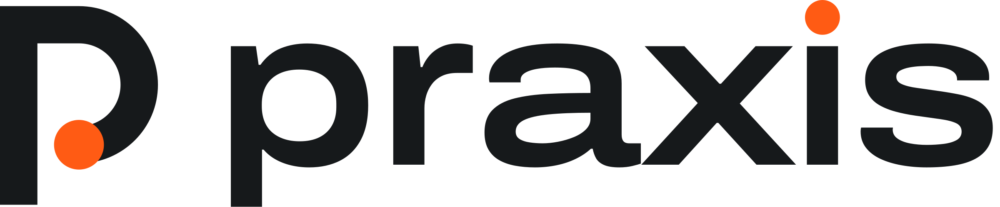
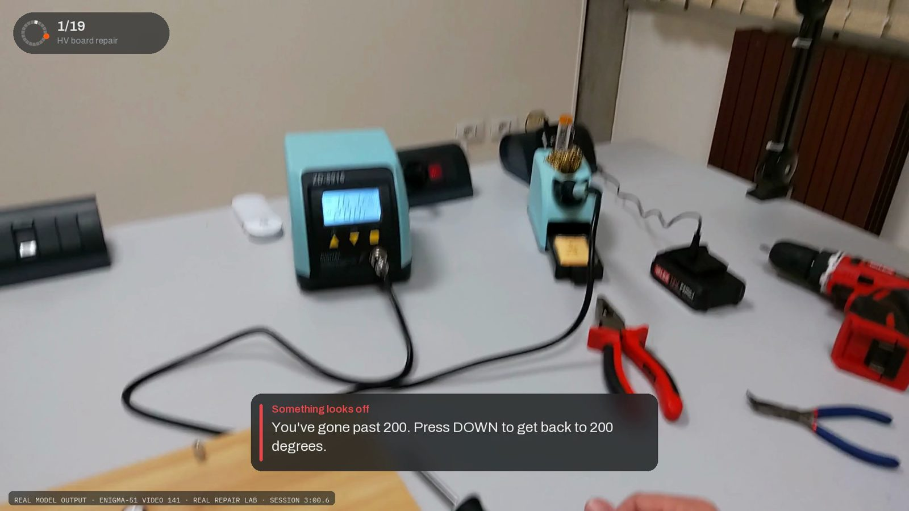
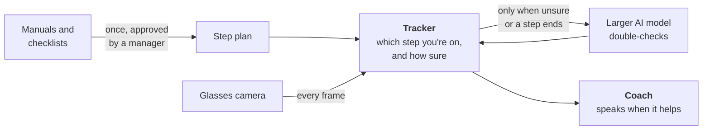
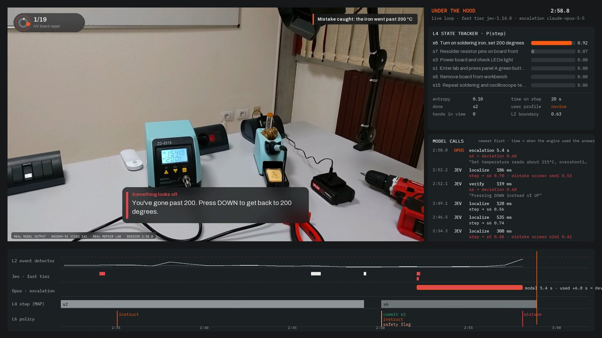
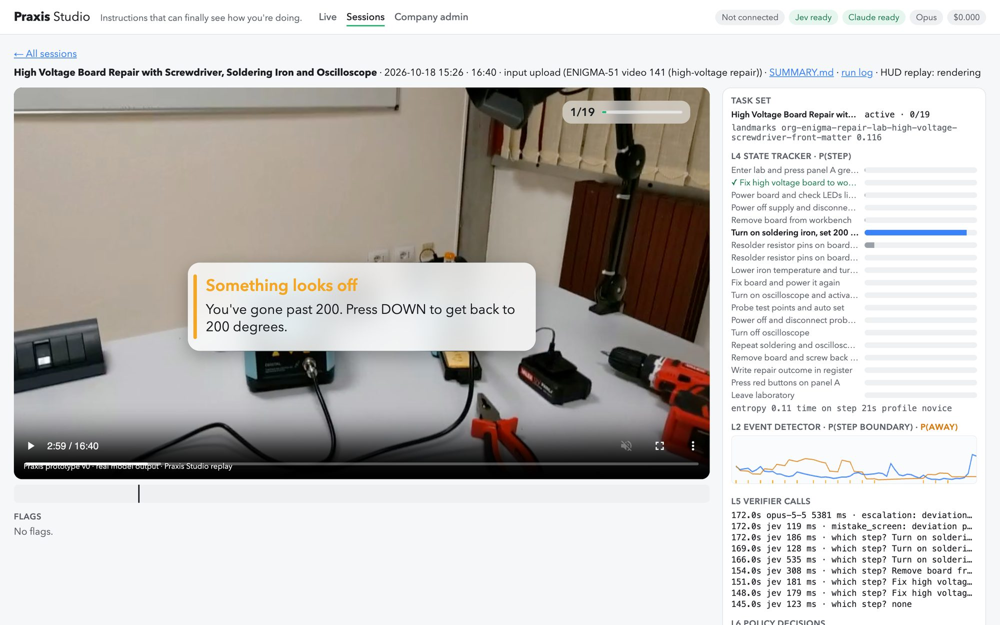
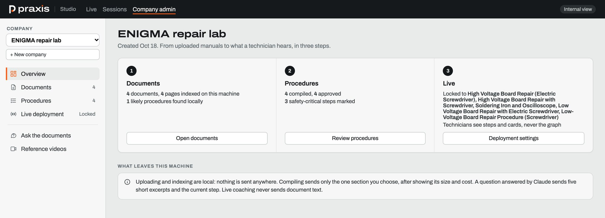
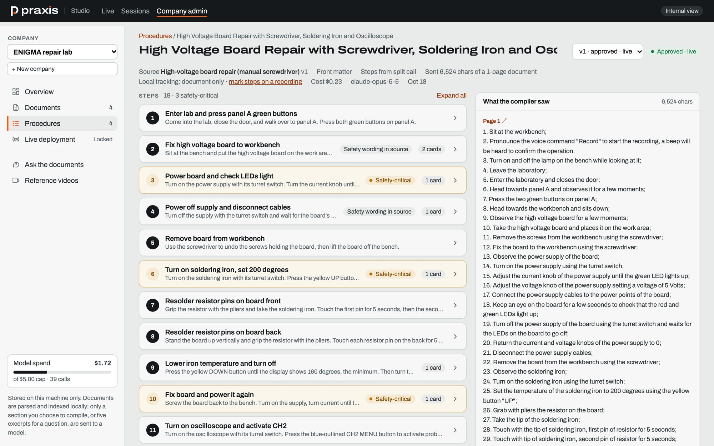
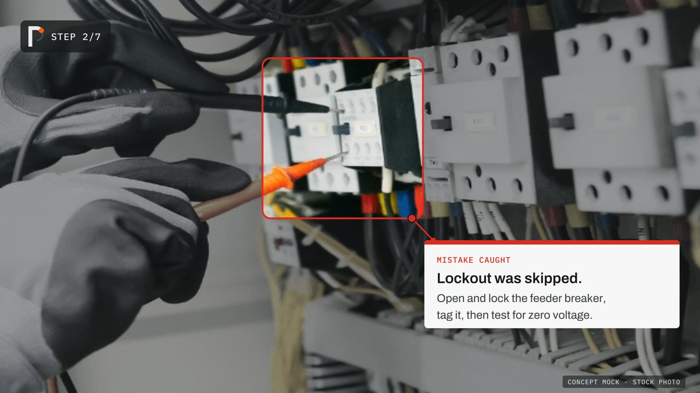

<p align="center">
  <picture>
    <source media="(prefers-color-scheme: dark)" srcset="brand/png/praxis-lockup-white.png">
    
  </picture>
</p>

<p align="center">
  <b>Instructions that can finally see how you're doing.</b><br>
  <i>AI guidance for the physical world.</i>
</p>

<p align="center">
  <a href="#try-it-praxis-studio">Try it</a> ·
  <a href="#how-it-works">How it works</a> ·
  <a href="#screenshots">Screenshots</a> ·
  <a href="#results-so-far">Results</a> ·
  <a href="https://praxis.monishsaravana.com">Public site</a>
</p>

---

Praxis is an AI coach for hands-on work, built for smart glasses. It watches the job through the wearer's camera,
knows which step they're on, tells them what to do next, catches mistakes with a specific fix, and asks for a better view when it
can't see well enough to be sure. We're starting with **new technicians in maintenance and repair**, who today
learn by shadowing a senior tech for weeks.

<p align="center">
  
  <br>
  <sub><b>Real model output.</b> What the technician sees: Praxis flags that the soldering iron went past 200 °C, on public first-person repair footage (ENIGMA-51). Drawn from a saved session log. Praxis ran on a laptop on the recorded video, not on glasses.</sub>
</p>

> **Status: prototype v0 (October 2026).** The engine runs live on a laptop, tested on recorded first-person video
> played back in real time. It has not been tested on glasses yet, and it has no customers or pilots yet. Every number in
> this repo comes from a real run (see [Results so far](#results-so-far) and [`docs/CLAIMS.md`](docs/CLAIMS.md)).

## Contents

- [What Praxis does](#what-praxis-does)
- [Who it's for](#who-its-for)
- [How it works](#how-it-works)
- [Screenshots](#screenshots)
- [Results so far](#results-so-far)
- [Try it: Praxis Studio](#try-it-praxis-studio)
- [Status and limits](#status-and-limits)
- [Repo map](#repo-map)
- [Docs index](#docs-index)

## What Praxis does

| Behavior | What the wearer experiences |
|---|---|
| **Recognizes the job** | It starts watching and works out which procedure you're doing. If it can't tell after about 30 s, it asks. |
| **Coaches step by step** | It says the next step when you're ready for it, with more detail if you're stuck on a step and less if you're moving fast. |
| **Checks the work** | It confirms a step is done by comparing what it sees with what "done" should look like. |
| **Catches mistakes** | It names the problem and the fix: "You've gone past 200. Press DOWN to get back to 200 degrees." |
| **Asks for a better view** | When the view is blurry or blocked, it asks you to look again instead of guessing. |

The display stays out of the way: a small progress ring, a short instruction, and a card only for a mistake or a
view request. Coaching is spoken, so it's designed to work on glasses without a display too.

## Who it's for

**First market: new technicians in maintenance and repair**, at plants, facilities, equipment-service companies
and technical training programs.

- **The problem.** New techs learn by shadowing a senior tech, which ties up the senior tech's time. Manuals and
  videos can't see what the new tech is doing.
- **Why glasses.** The work moves around the machine, so a camera bolted to a workstation can't follow it.
  A camera on the face can.
- **Why it fits.** The procedures already exist as checklists, manuals and work orders. Praxis turns them into
  coaching, so nobody has to write the content from scratch.

The longer-term plan (a record of the work and of who's certified to do it, models of our own, then training and
checking robots that work next to people) is in [`docs/VISION.md`](docs/VISION.md).

## How it works



1. **Load the procedures a company already has.** A manager uploads manuals or checklists. Praxis finds the
   procedures and turns each one into a step plan: the steps and their order, what each step looks like when it's
   done, the common mistakes and how to fix them, and how long each step usually takes. A person reviews and
   approves it before anyone is coached on it. Documents stay on the machine; only the section being compiled is
   sent to a model.
2. **Start the job.** The technician puts on the glasses and starts working. Praxis recognizes the procedure, or
   the manager assigns it.
3. **It keeps track of where you are.** Small models look at every frame and keep a running estimate of which step
   you're on and how confident it is. A larger AI model is asked to look only when something happens, which is
   about 1 frame in 7. That keeps it fast and cheap.
4. **It speaks only when it helps.** The next instruction, a confirmation, a mistake with its fix, or a request
   for a better view. If it isn't sure, it stays quiet or asks.
5. **It gets better with use.** With the customer's permission, sessions can become labeled training data for
   smaller models of our own, which makes it cheaper and faster over time.

The large AI model (today Claude Opus 5.5, with a faster model for routine checks) is one swappable part. The step
plans, the tracker, and the decisions about when to look and when to speak are ours. For the technical version, see
[`docs/ARCHITECTURE.md`](docs/ARCHITECTURE.md) and the [architecture diagram](brand/diagrams/architecture.png).

## Screenshots

All of these are real output from the prototype, except the last one, which is labeled as a concept mock.

### What the technician sees, and what's underneath

<p align="center">
  
  <br>
  <sub><b>Engineer view</b> of the same moment. Right: the tracker's belief over the steps, and each model call with its real latency. Bottom: when each part of the engine fired. This view is for demos and debugging; technicians never see it.</sub>
</p>

These are selected moments from one 16-minute session. Over the whole session Praxis confirmed 1 of 19 steps, and
this alert came just after the technician had already turned the iron back down. The full account is in
[`renders/demo/README.md`](renders/demo/README.md).

### Praxis Studio: run it, flag it, replay it

<p align="center">
  
  <br>
  <sub><b>Praxis Studio</b>, the browser app for running the engine on a camera or a video. Here it replays a saved session, paused on the logged mistake, with the engine panel open.</sub>
</p>

### Company admin: from a manual to coaching

<p align="center">
  
  <br>
  <sub><b>Overview.</b> Upload documents, approve the compiled procedures, then lock which ones technicians are coached on.</sub>
</p>

<p align="center">
  
  <br>
  <sub><b>Procedure review.</b> The 19 steps Praxis compiled from a lab's written instructions, with safety-critical steps marked, next to exactly the text the compiler was sent.</sub>
</p>

### Where it's going: on glasses

<p align="center">
  
  <br>
  <sub><b>Concept mock on a stock photo, not model output.</b> How a mistake card could look on glasses with a display.</sub>
</p>

**Videos.** The full repair demo is in [`renders/demo/`](renders/demo/) (user and engineer cuts). More clips, each
rendered only from saved run logs, are in [`renders/`](renders/), and the [public site](https://praxis.monishsaravana.com)
has the showcase clips and session replays.

## Results so far

Measured on held-out recordings from public first-person datasets, scored against the datasets' own labels.

| What we measured | Praxis | Comparison |
|---|---|---|
| Knowing which step someone is on (48 clips, task known) | **54%** | 48% for the same frontier model called every 5 s with no memory |
| Cost per minute of video | **$0.018** | $0.085 for that baseline, about 5× more |
| Blurred or blocked views | Asked for a better view on **77–98%** of checks, never confidently wrong | The baseline has to answer, and named the wrong step with at least 50% confidence on 12–73% |
| Recognizing the job with no setup | **73%** of clips, median 40 s | — |
| Repair videos with the written procedure uploaded (66 moments) | Right step shown **45%** of the time, right or next to it **74%** | 36% and 45% for a general vision assistant given the same procedure |
| Running live on a laptop | About **50 ms** of local work per frame; model calls never block it | — |

**Where it's weak.** Mistake detection is the weakest part: 4 of 17 mistake alerts named a real annotated error.
Most numbers come from cooking video (CaptainCook4D), because the labels for the assembly dataset were unreachable.
The repair numbers come from four ENIGMA-51 videos, with step labels derived from the dataset's object-interaction
labels.

Every number, with its source file, failure cases and what not to claim:
[`results/RESULTS.md`](results/RESULTS.md) and [`docs/CLAIMS.md`](docs/CLAIMS.md).

## Try it: Praxis Studio

```bash
cd prototype
uv run praxis studio
```

This opens <http://127.0.0.1:8800>. API keys come from `../.env`, and the first start loads the local models
(about 20 s). First-time setup (dependencies, model weights, keys) is in [`prototype/README.md`](prototype/README.md).

| Step | Options |
|---|---|
| **1. Input** | Your Mac's webcam, an iPhone through Continuity Camera, an uploaded video (played at real-time speed), or a test clip |
| **2. Task** | Auto-recognize · type what you're doing · paste instructions (compiled by Claude Opus 5.5 in about a minute, then cached) · pick from the library |
| **3. Run** | The video shows the technician's view. Toggle the **engineer panel** to see what the engine is doing, turn spoken coaching on or off, or use **Change task** if it picked the wrong one |
| **4. Flag** | Press <kbd>W</kbd> for "that's wrong" or <kbd>M</kbd> for "it missed something", with an optional note |
| **5. Save** | Stop, then Save or Discard. Saved sessions go to `sessions/<id>/` (video, run log, flags, a summary and a replay video) and show up on the **Sessions** page. Nothing is kept unless you press Save |

**Company admin** (the link in Studio's top bar) is where you create a company, upload manuals, review and approve
procedures, and lock what technicians are coached on. Details: [`docs/BACKEND.md`](docs/BACKEND.md).

<details>
<summary><b>Tips for a good live run</b></summary>

- **Use a library task and keep your hands in view.** Pinwheels is the easiest at a desk: a tortilla, nut butter,
  jelly, a butter knife and dental floss. Picking the task from the library skips recognition.
- **Expect a prototype.** It lags a few seconds after you finish a step and sometimes sticks on one. It catches only
  a few mistakes, mostly a wrong tool or wrong order.
- **For tasks outside the library, say or paste what you're doing.** From video alone it named 0 of 7 unseen
  recipes; with a short description it named 5 of 7. Pasted instructions give the most complete plan.
- **Cost.** About $0.12–0.27 per 15 minutes with Claude Opus 5.5 checks turned on, or about $0.02 with only the fast
  model. Each session has a cost cap (default $1); past it, Studio stops calling models and keeps tracking locally.

</details>

<details>
<summary><b>Other ways to look at the results</b></summary>

- **Local viewer** for the 48 evaluation clips (video, the tracker's belief over time, the event log and per-clip
  metrics):
  ```bash
  cd prototype && uv run python -m praxis.viewer fused
  cd .. && python3 -m http.server 8765    # then open http://localhost:8765/renders/viewer/
  ```
- **Public site** at <https://praxis.monishsaravana.com>: a static build of the landing page, showcase clips, the
  clip viewer and saved test-clip sessions. It calls no model. To rebuild and publish (needs the AWS CLI signed in):
  ```bash
  cd prototype && uv run python -m praxis.site build && uv run python -m praxis.site deploy
  ```
- **Reproducing a number:** every command is in [`prototype/README.md`](prototype/README.md).

</details>

## Status and limits

| Area | Where it stands |
|---|---|
| Engine | Runs live in real time on a laptop. Tested on recorded video played at real-time speed; Studio also takes a webcam or phone camera, but no camera session has been saved yet |
| Company admin | Built and run on real public manuals; extraction precision not measured yet |
| Smart glasses | **Not tested on hardware.** The camera input works with any video source; the Meta glasses adapter in this repo is a stub until a live stream has run end to end ([`docs/GLASSES.md`](docs/GLASSES.md)) |
| Voice | Praxis speaks its coaching. Talking back to it is designed but not in this repo yet ([`docs/VOICE.md`](docs/VOICE.md)) |
| Mistake detection | Weak so far (see [Results so far](#results-so-far)) |
| Customers | None yet. Outreach to maintenance managers started in October 2026 |

## Repo map

| Path | What's there |
|---|---|
| [`prototype/`](prototype/) | The engine and Praxis Studio (Python), with setup and exact reproduce commands |
| [`results/`](results/) | Every measured result as JSON, plus [`RESULTS.md`](results/RESULTS.md) (generated, never typed by hand) and [`figures/`](results/figures/) |
| [`renders/`](renders/) | Demo clips in the user and engineer views, rendered only from saved run logs. Failure cases are labeled |
| [`docs/`](docs/) | Product, strategy and technical docs (see the index below); README images live in `docs/images/` |
| [`brand/`](brand/) | Logo, colors and type, HUD concept mocks, the architecture diagram and every deck version |
| [`deck/`](deck/), [`deck-hv/`](deck-hv/) | The Startups@Harvard grant deck and the Harvard Ventures Demo Day deck |
| [`context/`](context/), [`prompts/`](prompts/) | The grant application as submitted, and the build briefs |
| [`tools/`](tools/) | Helper scripts for running Studio as a background service and for the public site |

## Docs index

**Product and strategy**
- [`VISION.md`](docs/VISION.md): the long-term plan, phase by phase, with what has to be true before each step
- [`POSITIONING.md`](docs/POSITIONING.md): what makes Praxis different, the first market, pricing and unit economics
- [`USE_CASES.md`](docs/USE_CASES.md): why maintenance and repair first, compared with the other markets we looked at
- [`COMPETITORS.md`](docs/COMPETITORS.md): what each competitor checks by camera today, from public sources
- [`PITCH_QA.md`](docs/PITCH_QA.md): hard questions and our answers

**How it's built**
- [`TECH_STUDY_GUIDE.md`](docs/TECH_STUDY_GUIDE.md): the whole system in plain language, stage by stage
- [`ARCHITECTURE.md`](docs/ARCHITECTURE.md): the layers, which parts are ours, and why the tracker works
- [`BACKEND.md`](docs/BACKEND.md): company admin, document handling and locked procedures
- [`MULTITASK.md`](docs/MULTITASK.md): switching between jobs and coming back to one
- [`MODEL_ROADMAP.md`](docs/MODEL_ROADMAP.md): which rented models get replaced by our own, and with what data
- [`GLASSES.md`](docs/GLASSES.md) · [`VOICE.md`](docs/VOICE.md): what glasses support and voice input need

**Evidence**
- [`CLAIMS.md`](docs/CLAIMS.md): exactly what's safe to say, each line linked to its source, and what not to claim
- [`DATA.md`](docs/DATA.md): datasets, licenses and splits
- [`TO_TEST.md`](docs/TO_TEST.md) · [`NEXT.md`](docs/NEXT.md): tests queued for later, and what to build next
