# Praxis

A real-time, stateful engine for first-person procedural guidance. It watches a task through a head-mounted
camera, keeps a probabilistic estimate of where the person is in the procedure, checks progress and mistakes
with typed visual questions, and decides when it is worth saying something.

The frontier vision-language model is one swappable component (the verifier), called only when the local
layers detect an event or become uncertain. Everything around it (event detection, task recognition, a Bayesian
semi-Markov state tracker over a compiled task graph, calibration, policy and a distilled local student) runs
on-device in milliseconds.

<p align="center">
  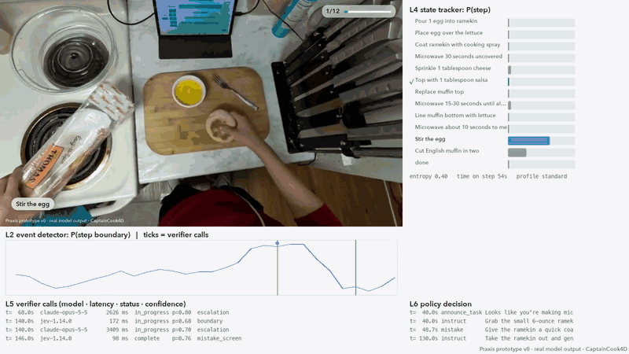
  <br>
  <sub><b>Engineer view, real model output.</b> Top right: the L4 tracker's belief over the task graph. Middle: the L2 event
  detector's boundary probability, with ticks where the verifier was called. Bottom: verifier calls (model, latency,
  calibrated confidence) and the policy's decisions. The person tears the muffin by hand; Praxis says to use the knife.</sub>
</p>

<table>
  <tr>
    <td width="50%">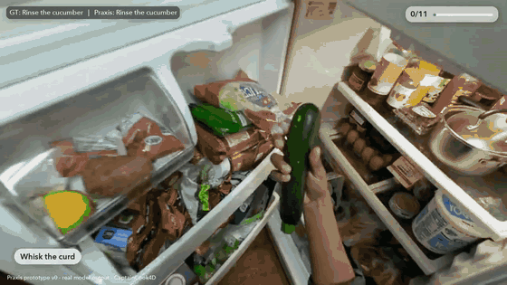</td>
    <td width="50%">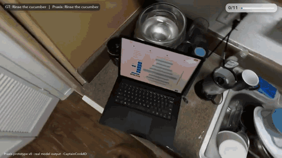</td>
  </tr>
  <tr>
    <td><sub><b>Wrong ingredient, caught mid-step.</b> "That looks like a zucchini, not a cucumber." Matches the dataset's annotated error.</sub></td>
    <td><sub><b>Asks instead of guessing.</b> When the region it needs is out of view, the verifier returns "can't see" and the policy asks for a view.</sub></td>
  </tr>
</table>

Every frame above is drawn from a saved run log on held-out video ([CaptainCook4D](https://captaincook4d.github.io/captain-cook/));
nothing is mocked. More renders are in [`renders/`](renders/).

---

## Contents

- [The problem with calling a VLM on every frame](#the-problem-with-calling-a-vlm-on-every-frame)
- [Architecture](#architecture)
- [How a tick works](#how-a-tick-works)
- [Results](#results)
- [Why it works](#why-it-works)
- [Running it](#running-it)
- [Repository layout](#repository-layout)

---

## The problem with calling a VLM on every frame

The obvious way to build a procedural assistant is to send recent frames to the strongest available
vision-language model every few seconds and ask "which step is this, and is anything wrong?". That baseline is
implemented here (`baseline_stateless`: Claude Opus 5.5 every 5 s, given the task name and the full step list) and
it fails in predictable ways:

1. **No memory.** Each call re-derives the step from a few frames. Procedures have structure (prerequisites,
   typical durations, things that only make sense after other things), and a stateless call throws it away.
   Order errors, the most common mistake type in the data, are invisible without knowing what already happened.
2. **No notion of "I can't see".** A free-form answer is always produced, so a blurred or occluded view gets a
   confident guess.
3. **Uniform cost.** It pays frontier latency and price on every tick, including the long stretches where nothing
   changes.
4. **No timing model.** It cannot tell a step that is taking long because the person is stuck from one that is
   simply long.

Praxis treats the VLM as a sensor rather than as the system: it asks it narrow, typed questions at the moments
that matter, calibrates its answers, and fuses them with cheap continuous local evidence in an explicit state
model.

## Architecture

<p align="center">
  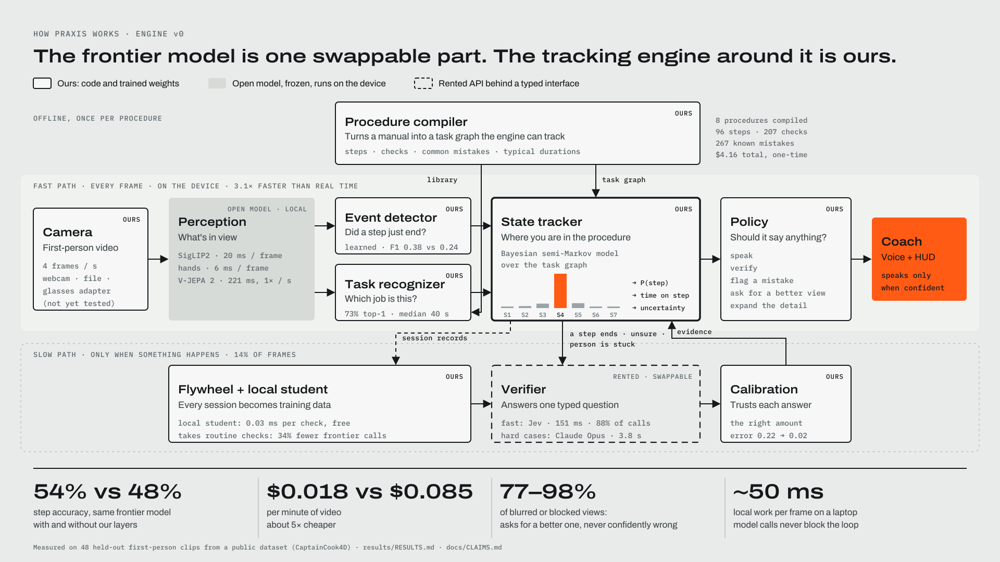
</p>

The engine is split into two paths that run at different rates.

**Fast path, every frame, on-device** (3.1× faster than real time on an Apple M4 laptop).

| Layer | What it does | Implementation |
|---|---|---|
| L0 input | Camera-agnostic frame source (file, webcam, replay; glasses adapter stubbed) | [`praxis/io/sources.py`](prototype/praxis/io/sources.py) |
| L1 perception | Frozen encoders: SigLIP2 image/text (20 ms/frame), MediaPipe hands (6 ms/frame), V-JEPA 2 on a trailing 2 s window once per second (221 ms) | [`praxis/perception/`](prototype/praxis/perception/) |
| L2 event detector | Learned causal TCN over L1 features: P(step boundary), P(action onset). Gates the slow path | [`praxis/events/detector.py`](prototype/praxis/events/detector.py) |
| L3b task recognizer | Accumulates evidence over a library of compiled procedures; drafts a new graph when nothing fits | [`praxis/tasks/recognizer.py`](prototype/praxis/tasks/recognizer.py), [`drafter.py`](prototype/praxis/tasks/drafter.py) |
| L4 state tracker | Explicit-duration HMM over the task graph. Maintains P(step), time-on-step and belief entropy | [`praxis/state_tracker.py`](prototype/praxis/state_tracker.py) |
| L6 policy | Decides whether to speak, verify, flag a mistake, ask for a better view, or expand detail; adapts verbosity to the user | [`praxis/policy/`](prototype/praxis/policy/) |

**Slow path, only at events** (14% of frames).

| Layer | What it does | Implementation |
|---|---|---|
| L5 verifier | `verify(frames, node, checks) -> Verdict`. Typed questions (`step_complete`, `mistake ∈ {none, known ids}`, `view_ok`) with a fast tier (Jev, ~150 ms) and escalation to a strong tier (Claude Opus) on ambiguity, suspected mistakes or bad views | [`praxis/verify/`](prototype/praxis/verify/) |
| Calibration | Isotonic calibration of each verifier's confidence, fit on train-split checks only | [`praxis/verify/calibration.py`](prototype/praxis/verify/calibration.py) |
| L7 flywheel | Every session is written as a training record; a local student is distilled from the frontier verifier's verdicts | [`praxis/flywheel/`](prototype/praxis/flywheel/) |

**Offline, once per procedure.**

| Layer | What it does | Implementation |
|---|---|---|
| L3 compiler | Turns a manual, recipe or work instruction into a typed `TaskGraph`: steps, prerequisites, visual end states, typed checks, a library of common mistakes with spoken corrections, and lognormal duration priors | [`praxis/tasks/compiler.py`](prototype/praxis/tasks/compiler.py), [`schema.py`](prototype/praxis/tasks/schema.py) |

Swapping the verifier is a one-line config change (`verifier.primary: jev | claude_fast | distilled` in
[`configs/default.yaml`](prototype/configs/default.yaml)).

## How a tick works

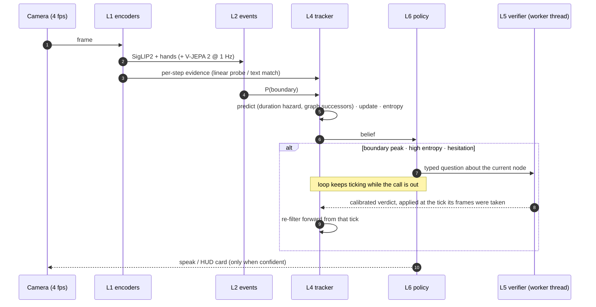

**The tracker.** The hidden state is *(active step k, seconds spent in k)*. Each tick:

- **Predict.** A step that has run about as long as it usually takes becomes likely to end, using a hazard derived
  from lognormal fits to train-split step durations. The next step must be a graph successor whose prerequisites
  are complete.
- **Update.** Three evidence streams are multiplied in, each tempered by a learned reliability: per-frame visual
  evidence from frozen features, L2's boundary probability, and calibrated verifier verdicts (worth several seconds
  of frame evidence).
- **Output.** The step posterior, its entropy and expected time on step. High entropy triggers a verification or a
  view request rather than a guess; time-on-step far above the prior triggers a hesitation check and more detailed
  instructions.

**Asynchronous slow path.** Verifier calls run on worker threads. A late answer is applied at the tick its frames
were captured and the filter is re-run forward from there, so the camera, encoders, tracker and policy never wait
on the network. Offline evaluation replays the same engine with calls inline, and a replay check confirms the two
produce identical records on recorded answers.

## Results

All numbers are on **48 held-out first-person clips (235 min) from CaptainCook4D**, covering 8 procedures, 302
annotated step segments and 170 annotated errors. Everything learned (detector, probes, recognizer, calibration,
student, policy thresholds, duration priors) used only the official train split, and design choices were selected
on train recordings before touching the eval clips. Every figure below is generated from the JSON in
[`results/`](results/) by [`tools/readme_figures.py`](tools/readme_figures.py); the complete write-up, including
methods and failure analysis, is in [`results/RESULTS.md`](results/RESULTS.md).

### 1. Same frontier model, with and without the engine around it

<p align="center">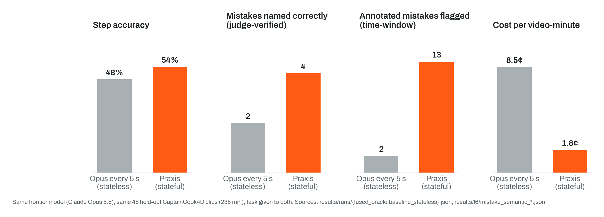</p>

Both systems use Claude Opus 5.5 as the strongest model and both are told the task. With the engine around it:

- **Step accuracy rises from 48% to 54%.**
- **Twice as many judge-verified mistake catches** (an Opus judge checks that the alert names the same problem as the
  annotation), and **6.5× as many annotated mistakes flagged** under time-window matching (13 vs 2). 77% of those
  flags arrived before the erroneous step had ended.
- **4.6× cheaper** ($0.018 vs $0.085 per video-minute). 86% of frames never leave the device, and 88% of the
  remaining calls are answered by the ~150 ms fast tier; Opus is reserved for escalations.

### 2. The state tracker is the multiplier

<p align="center">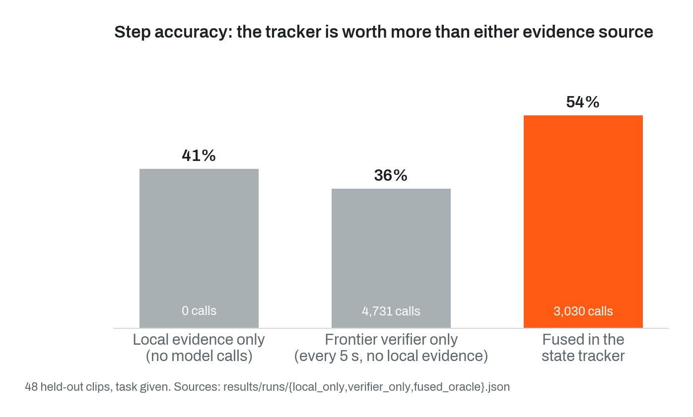</p>

Local evidence alone reaches 41%. The frontier verifier alone, called every 5 s, reaches only 36% while making
1.6× more calls. Fusing both in the semi-Markov tracker gives 54%: more than either source, with fewer calls than
verifier-only. The gain comes from the structure (graph constraints, duration priors, evidence weighting), not
from more model calls.

### 3. Calibrated uncertainty instead of confident guesses

<p align="center">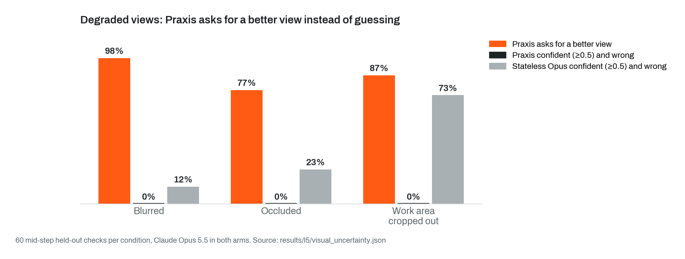</p>

On degraded views of held-out checks, the typed verifier is allowed to answer "can't see". Praxis asked for a
better view on 77–98% of degraded checks and was **never confidently wrong**. The stateless baseline must answer,
and named the wrong step with ≥0.5 confidence on up to 73% of them.

Isotonic calibration on train-split checks reduced the fast verifier's expected calibration error from
**0.22 to 0.02** on held-out checks, which is what makes its confidence usable as a likelihood inside the tracker.

### 4. Transfer to real repair work

<p align="center">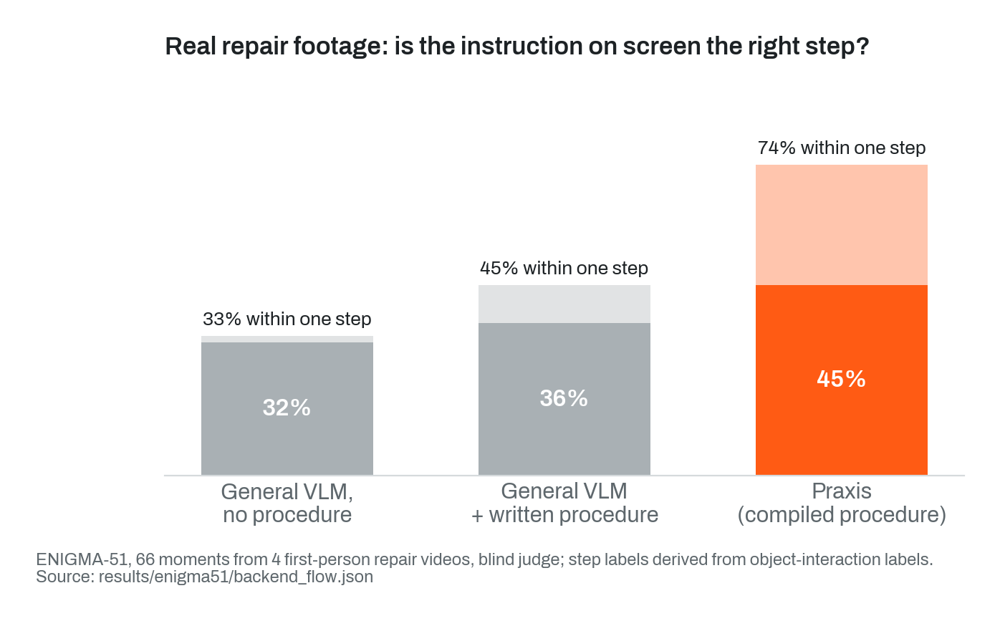</p>

<p align="center">
  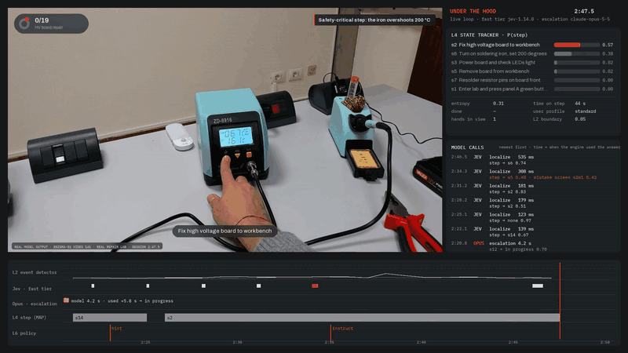
  <br><sub>A live session on ENIGMA-51 video 141 (high-voltage board repair). The procedure was compiled from the lab's written instructions; no model was trained on this task.</sub>
</p>

Written repair procedures from [ENIGMA-51](https://iplab.dmi.unict.it/ENIGMA-51/) were uploaded, compiled into task
graphs, and used to coach four first-person repair videos. On 66 judged moments, the instruction Praxis displayed
was the right step **45%** of the time and right-or-adjacent **74%**, versus 36% / 45% for a general VLM given the
same written procedure, and 32% / 33% with no procedure. Mid-task technician questions answered by retrieval over
the compiled documents were graded correct on **16 of 20**.

### 5. Real-time behaviour

<p align="center">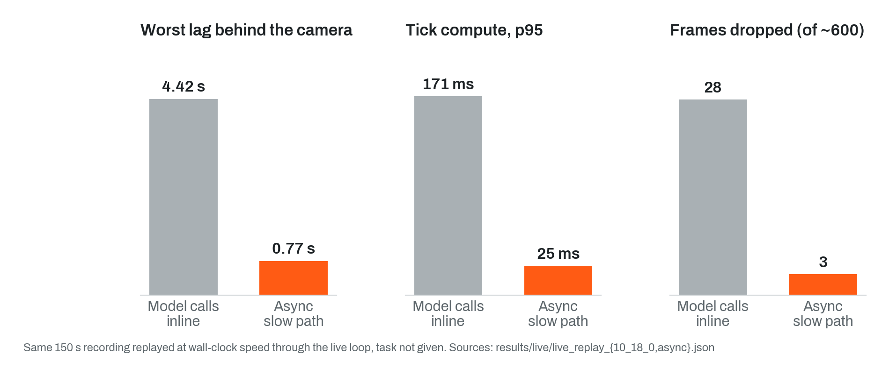</p>

The full engine runs live at 4 fps on a laptop, with ~50 ms of local work per frame. Moving verifier calls off the
loop cut the worst lag behind the camera from 4.4 s to 0.77 s and dropped frames from 28 to 3, while the loop kept
ticking through a 4.4 s Opus escalation. Folding a late answer back in costs 0.2 ms (median) on the main thread.
The task was recognized without being given, 22 s into the session.

### 6. Multi-task sessions: switch, pause, resume

<p align="center">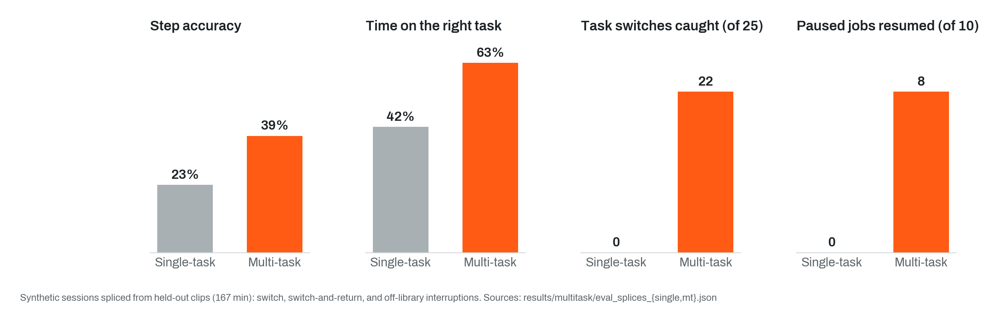</p>

The multi-task engine keeps a set of tasks with one active and others paused with their progress. On synthetic
sessions spliced from held-out clips, it caught **22 of 25** task switches, resumed **8 of 10** paused jobs (5 at
the exact step), and raised step accuracy from 23% to 39% over the single-task engine.

### 7. Distilling the frontier verifier

<p align="center">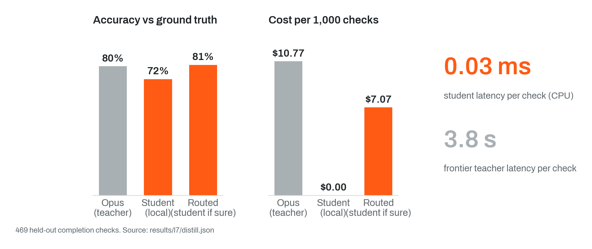</p>

A local student trained on Opus verdicts plus train-split labels answers a completion check in **0.03 ms on CPU**
at zero marginal cost. Routing a check to the student only when it is confident handles a third of checks locally
and slightly *exceeds* the teacher's accuracy (81% vs 80%), because the student is also supervised by ground truth.

### Other measured results

| Capability | Result | Source |
|---|---|---|
| Task recognition, no setup | 73% top-1 from a 9-procedure library, median 40 s | [`results/l3b/recognition.json`](results/l3b/recognition.json) |
| Joining mid-task | Starting 90 s in with no history: current step localized in 2.0 s median (vs 5.5 s assuming a fresh start); 47% vs 33% accuracy in the first 30 s | [`results/l3b/join_mid_task.json`](results/l3b/join_mid_task.json) |
| Learned event detector | Step-boundary F1 0.38 vs 0.24 for an SSIM heuristic (±5 s), with the gain holding on unseen procedure types (0.35 vs 0.19) | [`results/l2/l2_event_detector.json`](results/l2/l2_event_detector.json) |
| Scaling with data | Held-out step-probe accuracy 31% → 51% going from 1 to 9 training recordings (the 3 procedures that have 9), still rising; refitting local models on all train recordings raised call-free accuracy 41% → 49% | [`results/scaling/learning_curve.json`](results/scaling/learning_curve.json), [`results/runs/local_only_v2models.json`](results/runs/local_only_v2models.json) |
| Unseen procedures | Given a one-line description, a task graph is drafted in ~16 s, covering 64% of the reference steps, and tracked zero-shot | [`results/open_set/open_set.json`](results/open_set/open_set.json) |
| Procedure compilation | 8 procedures → 96 steps, 207 typed checks, 267 known mistakes with corrections, $4.16 total, one-time | [`results/l3/compile_summary.json`](results/l3/compile_summary.json) |
| Personalization | Same clip, novice vs expert profile: "Spread the nut butter in an even layer over the tortilla, but stop about half an inch before the edge" vs "Spread nut butter, half-inch border" | [`results/policy_demo.json`](results/policy_demo.json) |

## Why it works

- **State is the right inductive bias for procedures.** A procedure is a partially ordered sequence of steps with
  characteristic durations. Encoding that in an explicit-duration HMM means each observation only has to
  disambiguate among a few plausible successors instead of the whole step list, and the duration model carries the
  belief forward through uninformative frames. This is why fusion beats either evidence source alone (section 2).
- **Typed questions beat open-ended prompts.** The verifier is asked a closed question about one node
  ("is this end state reached?", "which of these known mistakes, if any?", "is the region visible?"). Answers map
  directly to likelihoods, can be calibrated, and include an explicit abstain option. Corrections come from the
  compiled mistake library, so alerts are specific and actionable.
- **Event-driven compute.** Most of a procedure is visually static. A learned boundary detector plus entropy and
  hesitation triggers concentrate model calls where the belief can actually change, which is why the engine is
  both cheaper and more accurate than polling.
- **Two-tier verification.** A fast typed model handles routine checks; disagreement, suspected mistakes and poor
  views escalate to the strong model. Escalation mainly buys precision on mistake alerts, which is what users notice.
- **The expensive model is a teacher, not a dependency.** Every call is logged as a training record, and the
  distilled student already takes over routine checks it is confident about. The system gets cheaper as it is used.

## Running it

**Praxis Studio** (local web UI: webcam, uploaded video or test clip; live HUD; engineer panel; session replay):

```bash
cd prototype
uv sync
uv run praxis studio        # http://127.0.0.1:8800
```

API keys go in `.env` at the repo root (gitignored): `ANTHROPIC_API_KEY` and `JEV_API_KEY`. Each session has a
spend cap (default $1); past it, Studio keeps tracking locally without model calls. With Opus escalation enabled, a
15-minute session costs roughly $0.12–0.27; fast tier only, about $0.02.

**Reproducing the evaluation.** Every experiment writes JSON under `results/`, and every number in
[`results/RESULTS.md`](results/RESULTS.md) is generated from those files. The exact commands (data download, feature
extraction, training, engine runs, judging, figures, renders) are in [`prototype/README.md`](prototype/README.md).

**Viewer.** `cd prototype && uv run python -m praxis.viewer fused` builds a per-clip HTML viewer with the video,
the synced belief over the task graph, the event log and metrics.

## Repository layout

| Path | Contents |
|---|---|
| [`prototype/praxis/`](prototype/praxis/) | The engine: one module per layer, plus `engine.py` (wiring), `live.py` (real-time loop), `runlog.py` |
| [`prototype/praxis/eval/`](prototype/praxis/eval/) | Evaluation harness, baselines, strict mistake judging, replay checks |
| [`prototype/praxis/studio/`](prototype/praxis/studio/) | FastAPI + WebSocket server and web app for live sessions |
| [`prototype/praxis/knowledge/`](prototype/praxis/knowledge/) | Document ingestion and the procedure backend (upload, compile, review, retrieval) |
| [`prototype/taskgraphs/`](prototype/taskgraphs/) | Compiled task-graph library |
| [`prototype/tests/`](prototype/tests/) | Tests, including the async slow path and cache determinism |
| [`results/`](results/) | Raw results JSON, generated `RESULTS.md`, figures, failure analysis |
| [`renders/`](renders/) | User-view and engineer-view videos rendered only from saved run logs |
| [`docs/`](docs/) | [`ARCHITECTURE.md`](docs/ARCHITECTURE.md), [`MULTITASK.md`](docs/MULTITASK.md), [`BACKEND.md`](docs/BACKEND.md), [`DATA.md`](docs/DATA.md) (datasets, licenses, splits), [`MODEL_ROADMAP.md`](docs/MODEL_ROADMAP.md) |

Datasets: [CaptainCook4D](https://captaincook4d.github.io/captain-cook/) (evaluation), [ENIGMA-51](https://iplab.dmi.unict.it/ENIGMA-51/)
(repair transfer), [IndustReal](https://github.com/TimSchoonbeek/IndustReal) (qualitative assembly demos). All
labels used for scoring are the datasets' own.
