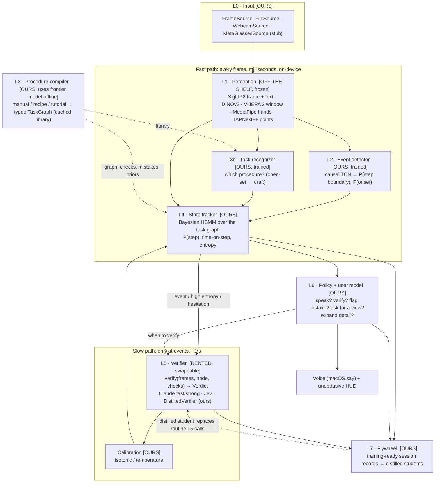

# Praxis v0 architecture

**Instructions that can finally see how you're doing.** Praxis is a layered, real-time task-state
engine. Most layers are ours. The frontier model is one swappable part (the L5 verifier) that runs only
when something happens.

## Layer diagram

Legend:
- **OURS**: code and learned weights we own.
- **OFF-THE-SHELF**: frozen open models (Apache/MIT) that run locally.
- **RENTED**: an API behind a typed interface. Swapping it is a one-line config change
  (`verifier.primary: jev | claude_fast | distilled` in `prototype/configs/default.yaml`).

## Two speeds
- **Fast path (every frame).**
  - L1 runs on each frame: SigLIP2 image embedding, hand landmarks, and the 1–SSIM change score. A V-JEPA 2
    embedding of the trailing 2 s window is computed once per second. (DINOv2 is extracted offline only, for the
    backbone comparison.)
  - L2 scores step boundaries and onsets. L3b accumulates task evidence. L4 folds in local evidence once per
    second.
  - Measured speeds are in `results/l1/l1_speed.json` and `results/RESULTS.md`.
- **Slow path (events only).** The verifier is called only when one of these happens:
  - L2 fires a boundary or onset peak.
  - L4's belief entropy is high.
  - Time on step far exceeds the step's prior (hesitation).

  Its verdict is calibrated, then enters L4 as a high-weight observation. L6 decides what, if anything,
  the wearer hears. The share of frames that reach the slow path is reported as "escalated frame share".

## The state tracker (L4): why it works
`prototype/praxis/state_tracker.py` is an explicit-duration HMM (hidden semi-Markov model).
- **State.** The hidden state is *(active step k, seconds spent in k)*.
- **Predict.** Each tick, a step that has run as long as it usually takes becomes likely to end. The hazard
  comes from a lognormal fit to train-split step durations. The next step must be a graph successor whose
  prerequisites are done.
- **Update.** Three kinds of evidence are multiplied in, each tempered by its reliability:
  - cheap per-frame visual evidence (a linear probe over frozen features, or zero-shot SigLIP2 text match);
  - L2's boundary probability;
  - verifier verdicts, which count like several seconds of frame evidence.
- **Outputs.**
  - The step distribution.
  - Its entropy. High entropy means verify or ask for a view, not guess.
  - Expected time on step, which drives the adaptive-detail logic in L6.
- **Mid-task join.** When joining mid-task, the prior is spread across all steps; once the tracker localizes,
  the step's graph ancestors are marked done.

## Interfaces (one module per layer)
| Layer | Module | Interface |
|---|---|---|
| L0 | `praxis/io/sources.py` | `FrameSource.__iter__() -> Frame(t, rgb)` |
| L1 | `praxis/perception/backbones.py`, `tracks.py`, `extract.py` | `SigLIP.images/texts`, `VJEPA2.clips`, `Hands.frame`, `PointTracker.seed/update` |
| L2 | `praxis/events/detector.py` | `score(ClipFeatures) -> {boundary, grasp}` |
| L3 | `praxis/tasks/compiler.py`, `schema.py` | `compile_procedure(...) -> TaskGraph` |
| L3b | `praxis/tasks/recognizer.py` | `update(t, frame_emb, window_emb) -> Recognition` |
| L4 | `praxis/state_tracker.py`, `praxis/evidence.py` | `predict / observe_local / observe_boundary / observe_verdict -> Belief` |
| L5 | `praxis/verify/{schema,claude,jev,calibration}.py`, `flywheel/distill.py` | `verify(VerifyRequest) -> Verdict` |
| L6 | `praxis/policy/{policy,user_model}.py` | `should_verify / on_verdict / hesitation -> [Action]` |
| L7 | `praxis/flywheel/{records,distill}.py` | `export(run_log) -> praxis.record/1`, `DistilledVerifier` |
| glue | `praxis/engine.py`, `praxis/runlog.py`, `praxis/render/hud.py`, `praxis/eval/*` | JSONL run log → renders, metrics |

## Moat: what compounds over time
1. **The task-graph library.** Every compiled procedure gives typed nodes, visual end states, typed checks,
   a mistake library with spoken corrections, and duration priors. Its value grows with each procedure;
   recognition (L3b) and local matching (L4) get better as it grows.
2. **The state tracker.** Persistent, uncertainty-aware procedural state is what a stateless "look at this
   frame" model lacks. The stateful-vs-stateless ablation in `results/RESULTS.md` measures exactly this.
3. **The calibrated policy.** Thresholds are tuned for precision on real sessions. People abandon coaching
   tools over false alarms, and every session improves the calibration data.
4. **Distilled models.** The frontier verifier labels routine checks; our local student learns them, and
   routine checks move from ~1 s and paid to ~1 ms and free. The first step of this is measured in
   `results/l7/`.
5. **Procedural data.** Every session writes a training-ready record (`praxis.record/1`): features, beliefs,
   typed questions and verdicts, actions and outcomes. Future in-house models train on these directly.
