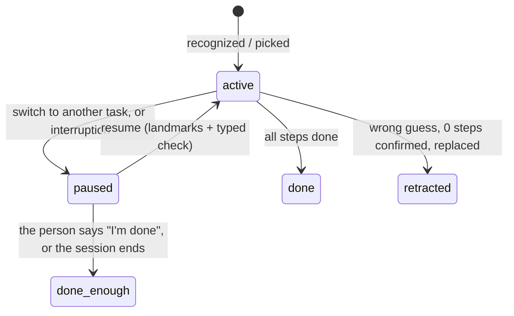

# Multi-task Praxis: design note

Status: approved by the founder on 2026-10-17 (decisions in section 10). Decision 1 was changed the same day: no
done-enough timer; Praxis asks instead. Built; see section 11 for what changed while building.
Starting tracked spend: **$104.88** (the founder's figure, 2026-10-17). Cap for this whole task: $20, so all calls
stop at **$124.88**. `python -m praxis.spend` sums only recorded costs and reads $98.46 at the start. This task's
spend is therefore that reading minus $98.46, and it may not pass $20.

## 1. The problem, verified

- `engine.py` runs task recognition only while `self.graph is None` (`Engine.tick`, line 223). After the first
  commit, the recognizer and the typed "which task?" check stop for the rest of the session. The task never changes
  unless the person types a new one in Studio, and that path throws away the old task's state (`start_task`).
- The tracker (`state_tracker.py`) covers the committed graph's steps plus DONE. It has no state for "doing
  something else", so it can't register a poor fit. It always spreads its belief over the wrong recipe's steps.
- Automatic run `fused` (48 eval clips): 12 clips were committed to the wrong recipe and 1 to none. All 13 score
  **0%** step accuracy. Given the recipe (`fused_oracle`), the same 13 clips score **30–93%**. Wrong commits came
  between 10 s and 184 s. Source: `results/runs/fused.json`, `results/runs/fused_oracle.json`.

Real use breaks the one-task assumption in four ways. People do one task after another. They stop at about 90%
because it's done enough for them. They get interrupted (feed the baby, take a call) and come back. And sometimes
they were never doing the recipe Praxis guessed first.

## 2. What the existing signals can do ($0 checks, before designing)

I ran these on stored features and logs only, with no model calls.

| Signal | Check | Result | What it means for the design |
|---|---|---|---|
| Typed "which step?" answers of **"none of these"** (already paid for in every run) | Share of answers per clip in `runs/fused/*.jsonl` (eval logs) | Wrong-recipe clips: 0.80–1.00 (mean 0.90). Correct clips: 0.40–0.96 (mean 0.67) | A real poor-fit signal, but it overlaps. It can trigger a re-check. It can't decide a switch by itself. |
| Local task recognizer (linear probe), kept running after commit | Its top-1 over each second after commit (eval clips) | Matches the true recipe 31% of the time on correctly committed clips, 25% on wrong ones | Too weak to drive switches. It's a weak prior only. |
| **Landmarks**: SigLIP2 frame vs "a photo of <part>" for every `parts` entry in each graph, weighted by how few recipes share the part | 30 s windows, 24 **train-split** recordings (3 per recipe), 216 windows | Picks the right recipe in **60%** of windows (chance 12.5%). With plain averaging instead of the top-20% frames, 49% | Usable, ms-cheap evidence for which task the person is near. |

The first two checks read eval-split logs. I used them only to decide what is worth building. No threshold
comes from them; thresholds come from the train split (section 7).

## 3. Design

### 3.1 An "away" state in the tracker (the founder's off-recipe state)

The tracker gets a second copy of every (step, dwell) state, meaning *away from this task while at step k*.

- On-task (k, d) → away (k, d) with a small rate ε per second. Away (k, d) → back at (k, d) with rate ρ. While
  away, the dwell clock stops. Coming back after feeding the baby doesn't look like a step that took 20 minutes.
- Where you are in the task stays the step belief, P(k) = on(k) + away(k). So step accuracy and the "current step"
  don't change meaning, and **P(away)** is a separate read-out.
- What feeds the away states:
  1. a local off-task score at 1 Hz: the active task's landmark score relative to the other tasks' scores, plus the
     recognizer's P(this task);
  2. "none of these" answers from the typed "which step?" check, which already happen, so this costs nothing extra.
- While P(away) is high, the policy doesn't verify or coach the active task's steps. That should also save calls on
  wrong-recipe clips.
- **Poor fit** = mean P(away) over the last W seconds above θ_fit.

### 3.2 Task confidence: a belief, not a lock

Each task in the set has a confidence that keeps updating after the commit:

- **Up:** steps verified or committed for that task, and typed "which task?" answers that name it.
- **Down:** sustained P(away), and typed answers that name another task.
- **Steps of another recipe count for that recipe.** Landmarks of task B, and B's step end-states, are scored every
  second for every library task. Seeing B's things raises B.
- The bar for switching away from a task rises with each confirmed step:
  `p_switch ≥ θ_switch + κ · confirmed_steps(A)`. A wrong guess with nothing confirmed is easy to drop. A task
  five steps in is hard to drop on one noisy answer.

### 3.3 Re-checking the task after commit

- On poor fit, run the existing typed "which task?" check. Its options are the library, the paused tasks and
  "none / something else". Each check costs about $0.0001: 503 task checks in `fused` averaged $0.00011.
- **Names another task B, and B's landmarks agree:** switch to B (section 3.4).
- **Confirms A:** stay, and back off before the next re-check (30 → 60 → 120 s), so a clip that fits poorly
  doesn't keep paying for checks.
- **"Something else":** treat it as an interruption. A pauses, and nothing new starts.
- Rate limit: at most one re-check per 20 s, and a per-task cap per 10 minutes. Spending is dominated by Opus
  escalations (`fused` cost $4.10 for 3235 calls), not by these checks.
- Optional knob, tested on train only: since a wrong first guess can now be undone, recognition could commit
  earlier, with a lower threshold or a shorter hold. That might also help the one clip that was never recognized
  (7_19_0). I'll test it, not assume it.

### 3.4 A task set: active, paused, done, done enough

- Each task keeps its own tracker, policy, mistake/order state and async journal. `Engine.graph`, `.tracker` and
  `.policy` become the active task's, so the rest of the engine is unchanged.
- **Pause keeps everything:** completed steps, current step, time on step. Nothing is discarded right away. Answers
  still in flight for a paused task are folded into its tracker but never spoken.
- **Resume restores it** at the step it was paused at. Two things can trigger a resume check: the active task
  finishing while something is paused, or the person looking at a paused task's landmarks while the active task
  fits poorly.
- **Retract:** if the first guess is replaced before any step of it was confirmed, it's marked a wrong guess
  rather than paused. Praxis says so in one line and doesn't offer to resume it.
- The Studio "Wrong task? Say what you're doing" box pauses the current task instead of discarding it.

### 3.5 Landmarks

- **Task landmarks:** the union of every node's `parts` in the compiled graph, plus a few optional per-task anchors
  (e.g. "stove top", "cutting board"). They're derived when the graph loads, so the 9 existing graphs need no
  recompilation and no Opus spend. The extras live in `prototype/configs/landmarks.json` (no schema change).
- **Weighting:** a landmark counts in proportion to how few tasks share it (IDF). "Bowl", "microwave" and a
  technician's toolbox appear everywhere and carry almost no weight. "Tortilla" and "filter rack" carry a lot.
- **Non-task landmarks:** a small configurable list, e.g. a baby, a crib, a door, a phone in hand, a person talking
  to the camera; for technicians, the van or a customer. With high P(away) they mean *interruption*: the task
  pauses without a "which task?" call. They never end a task.
- **Cost:** one SigLIP2 frame embedding already exists per frame. Text embeddings are computed once per graph.
  Scoring is one matrix product per second, well under a millisecond for about 200 landmarks.
- CaptainCook4D has no babies or doors, so non-task landmarks **can't be measured** here. They ship behind a flag
  and are labeled unmeasured until there's real footage (Studio sessions).

### 3.6 Leaving with steps left

- **The leave moment:** a task pauses with open steps, either because another task started or because an interruption
  was confirmed. Praxis gives the leave warning and asks about coming back, in the same line:
  - interruption: *"Before you go, one more step on the burritos: add the salsa. Coming back to the burritos?"*
  - switch: *"Looks like you've moved on to making cucumber raita. I paused the breakfast burritos at: add the salsa.
    Coming back to the breakfast burritos?"*
  The reminder part (the next open step) is said once per task. The question is asked at each such pause. Later,
  steps tagged as safety-critical in a compiled checklist could come first; the current graphs have no such tag.
- No warning and no question if the task was a wrong guess (retracted), or if none of its steps was done yet.
- **Answers (Studio):** two tap buttons on the paused chip, *Coming back* and *I'm done*, or a short reply typed in
  the existing box ("I'm done", "coming back later"). Studio has no speech input, so there is no spoken answer yet.
  - *Coming back* keeps the task paused with its state.
  - *I'm done* closes it as done enough, logged with its open steps. If it was the current task (an interruption),
    Praxis goes back to recognizing what comes next.
- **No answer:** the task stays paused quietly and its chip stays. It is closed as done enough only when the session
  ends, never on a timer. The session record lists which steps were never done, which is the system-of-record view
  of the same event.
- Not adjustable per task for now. Onboarding questions about the person's life and job could set expectations
  later; that is out of scope here.

### 3.7 Two examples

**Kitchen.** Breakfast burritos, egg cooked, salsa not added yet. The baby cries and the person walks to the crib.
P(away) rises, and the crib landmark fires, so this is an interruption. The burritos pause at step 4 with no model
call. After T_leave Praxis says "Before you go, one more step on the burritos: add the salsa. Coming back to the
burritos?" A chip shows "Burritos · paused at step 4" with *Coming back* / *I'm done*.
The person comes back and the tortilla and salsa are in view. The burritos' landmarks score high, and a typed check
confirms. "Back to the burritos. Next, the salsa." If they start cucumber raita instead, the check names the raita.
The burritos stay paused, and Praxis says "Looks like you've moved on to the raita. I'll keep the burritos where
you left them."

**Technician (the wedge; illustrative, there's no technician footage yet).** A new tech is doing a preventive-maintenance checklist on rooftop unit RTU-3. They've
locked out the disconnect, opened the access panel and swapped the filters. Then the lead calls them to the boiler
room. Leaving the unit (the cabinet, the filter rack and the belt drop out of view) raises P(away). A phone in hand
is a non-task landmark, so the PM pauses at "check belt tension". "Before you go: RTU-3's access panel is still off
and the belt hasn't been checked." The toolbox goes with them everywhere, so it carries no weight either way. If
the boiler task is in their work order (compiled from the site's checklist), the check names it and Praxis
coaches that instead. Back on the roof, the filter rack and the open panel are in view, and the parts bin they
left there helps too. "Back to RTU-3. Next, check the belt tension." If they tap *I'm done*, or never return before
the session ends, the PM becomes done-enough, and the work record shows two steps not done.

## 4. Run-log events (the renderer, Studio and eval read only these)

| Record | When | Fields |
|---|---|---|
| `belief` (extended) | 1 Hz, as now | adds `task_id`, `p_away`, `task_conf` |
| `landmarks` | 1 Hz | top-3 task landmark scores per task (`{task: score}`), the top non-task landmark and its score |
| `task_check` (extended) | each typed "which task?" call | adds `reason`: `recognize` \| `poor_fit` \| `resume`, and `options` |
| `task_state` | each change | `task_id`, `from`, `to` (`active`\|`paused`\|`done`\|`done_enough`\|`retracted`), `reason` (`switch`\|`interruption`\|`resumed`\|`finished`\|`user_done`\|`session_end`\|`wrong_guess`\|`user_switch`), `step_index`, `n_steps`, `at_step`, `evidence`; `open_steps` when closed as done enough |
| `task` (unchanged) | a task becomes active for the first time | as now, so old logs and tools keep working |
| `action` (new kinds) | spoken or shown | `switch_task`, `resume_task`, `leave_warning`, `retract_task` (a line that asks carries `detail.ask_resume`) |
| `ask_resume` | "Coming back to ...?" asked | `task_id`, `question`, `open_steps` |
| `resume_answer` | the person answered | `task_id`, `answer` (`coming_back`\|`done`), `via` (`tap`\|`typed`) |

## 5. Studio UI (`studio/static/app.js`, `hud.js`, `index.html`; `render/hud.py` gets the same rules)

User view, still voice-first, never showing the step graph:

- **Switch:** a short card plus one spoken line. "Looks like you've moved on to the raita. I'll keep the burritos
  where you left them."
- **Resume:** a card plus one spoken line naming only the next step. "Back to the burritos. Next, the cheese."
- **Leave warning:** a soft amber card plus one line, with the reminder spoken once per task and the question
  "Coming back to the burritos?". It's not the red mistake card.
- **Retract:** "My mistake, this looks like the raita." The progress pill resets with no other fuss.
- **Paused chip:** small and muted, under the progress pill: "Burritos · paused at step 4", with *Coming back* /
  *I'm done* buttons until answered. It shows at most two and disappears when the task resumes or is closed as done
  enough. The progress pill always shows the active task.

Engineer panel: a task-set table (task, status, step k/n, time paused, confidence), a P(away) trace next to the L2
trace, top landmark scores, and the task checks marked by reason.

## 6. Metrics

Before/after, both re-runs (automatic and task-given):
- task top-1 on the first announcement (as now), the final task correct, and the share of clip time on the right
  task;
- step accuracy, and step accuracy after recognition;
- the number of 0% clips;
- **wrong switches**, meaning a switch away from the recipe actually being done;
- verifier calls and cost.

The task-given run must not get worse. Its task is fixed, so only the away state can affect it. If step accuracy
drops there, ε and the off-task weight go back to the train split.

## 7. Evaluation plan

**Thresholds from the train split only** (as in 'Design selection'):
- Parameters: ε, ρ, off-task weight, W, θ_fit, θ_switch, κ, T_leave, and the optional earlier commit.
- Step probes and the recognizer are refit leave-one-recording-out, so no recording scores itself.
- First a free sweep with the local layers only, to set the away state. Then a small paid sweep for the switch
  thresholds.
- Choice rule: the highest mean step accuracy over train single-task clips plus train splices, among configs with
  no more wrong switches on single-task train clips than the current engine (which makes none). Ties go to fewer
  calls.

**Synthetic multi-task benchmark (clearly labeled SYNTHETIC).** CaptainCook4D has one recipe per video, so I'll
splice recordings. Cuts fall at annotated step boundaries, so "resume at the right step" has a defined answer.
There's a train-split version for thresholds and an eval-split version for reporting. The eval set uses a fixed
seed, about 2.9 h in total:

| Sequence | Count | Length | Measures |
|---|---|---|---|
| A (5 min) → B (5 min), different recipes | 6 | ~60 min | switch detection latency, wrong/missed switches, step acc. on each part |
| A to a step boundary → B (~2.5 min) → rest of A | 10 | ~75 min | the above + **resume accuracy**: resumed A at all, at the GT step (exact / ±1 step), time to resume |
| A to a step boundary → 60 s of a recipe not in the library (Coffee, Ramen, …) → rest of A | 6 | ~36 min | interruption: no switch to a library task, A resumed at the right step, leave warnings |

Splices cut hard (the camera jumps). Real switches are gradual, since people walk between stations. So detection
latency here can't stand in for real-life latency, and the write-up will say so. Replay has no user, so every
"Coming back to ...?" goes unanswered: the benchmark scores the no-answer behavior (paused tasks stay paused and close
at session end), and the write-up will say that too. Results go through
`write_results.py` into RESULTS.md and metrics.json from measured runs only. Nothing gets committed until the
founder asks.

## 8. Spend plan ($20 cap, approval before every paid run)

| Step | Paid? | Estimate |
|---|---|---|
| This note | no | $0 |
| Engine changes, unit tests, $0 local checks | no | $0 |
| Smoke test (2 clips + 1 splice) | yes | ~$0.30 |
| Train-split thresholds (free local sweep, then a small paid sweep) | yes | $2–4 |
| Automatic re-run, 48 clips | yes | $4–5 (last time $3.59) |
| Task-given re-run, 48 clips | yes | ~$4.50 (last time $4.31) |
| Synthetic benchmark, eval split, ~2.9 h | yes | ~$3 |
| Studio UI check | maybe | $0–1 |
| **Total** | | **~$14–18 of $20** |

Before each paid run I'll post an itemized estimate and wait for a yes. Every run gets a hard
`Budget(max_calls, max_usd)` set to no more than what's left of the $20, so calls stop at the cap even mid-run.
After each run I'll report the actual cost and the running total. Cached answers cost $0, so actual spend can come
in under the estimate.

## 9. Risks

- Most wrong commits were between similar recipes: burritos vs pinwheels, omelet vs tomato-mozzarella salad. The
  typed check may confuse the same pairs again. I expect partial recovery of the 13 clips, not all of them.
- A false switch on a correct clip costs that clip's steps until it switches back. The κ term and the train-split
  choice rule exist to keep wrong switches at zero on single-task clips. If they can't, the switch threshold goes
  up, and fewer wrong clips recover.
- The away state could hold back legitimate progress on the task-given run. That's the regression check in
  section 6.
- Non-task landmarks and real interruptions can't be measured on this dataset (section 3.5).

## 10. Decisions for the founder

Decided by the founder on 2026-10-17:

1. **Paused → done enough:** no timer and no per-task setting. Praxis asks "Coming back to the ...?" at the leave
   moment. "I'm done" closes the task; no answer keeps it paused until the session ends (section 3.6). This replaced
   the first answer (10 minutes).
2. **Leave warning:** spoken, once per task.
3. **Retract line:** said out loud in one short line ("My mistake, this looks like the raita").
4. **Earlier first commit:** tested on the train split as an option.

## 11. As built (changes from the plan, and why)

- **Off-task evidence** is a two-feature logistic model over landmark scores (`landmarks.OffTaskModel`), fit on the
  train split with grouped CV (`experiments.fit_offtask`). AUC on-task vs off-task seconds: 10 s window 0.842, 20 s
  0.871, 30 s 0.888, 60 s 0.914 (`results/multitask/offtask_fit.json`).
- **The away state comes in three forms**, compared on the train split (`eval/multitask.free_away_sweep`):
  `joint` (the planned away copy of every step state), `factored` (a separate P(away) that slows the step clock and
  tempers step evidence) and `decoupled` (a separate P(away); the step filter is untouched until an interruption is
  confirmed, then it freezes). The step-switch commit now uses the on-task belief: 0.6% of belief mass "away" at the old
  step was enough to keep P(next step) at 0.698, under the 0.70 commit threshold, and lose 15 points on one recording.
- **Re-check triggers:** poor fit, plus another task newly leading on landmarks (so a confirmation's back-off can't
  delay a real switch). A typed answer that confirms the current task counts as on-task evidence.
- **Grace period:** after a switch or resume, away evidence waits one landmark window, because the window still shows
  the previous task. The first minute of a recording had the same problem (a false interruption while the window
  filled).
- **Wording:** a switch says where the old task stopped ("I paused the breakfast burritos at: whisk egg until
  uniform"). A resume names only the next step. The standalone "Before you go..." reminder is for interruptions. An
  interruption resumes silently unless it lasted 30 s or a reminder was spoken.
- **Retract** requires no completed step *and* under 2 minutes on the task. A real task with no confirmed step yet was
  being called a wrong guess.
- **Free train sweep result** (`results/multitask/free_away_sweep_{joint,factored,decoupled}.json`, 24 single-task
  recordings + 18 SYNTHETIC splices, task given, local layers only, no model calls). Task-given step accuracy without
  away states: 54.5%. Every joint config: 51.2–53.2%. Every factored config: 50.6–53.3%. Every decoupled config: 54.5%
  (unchanged by construction until an interruption is confirmed). AUC of P(away) for off-task seconds: 0.845–0.859
  across all three. Chosen: decoupled, 20 s landmark window, enter 0.005, return 0.05, weight 0.3 (AUC 0.857).
- **Interruptions need the typed check.** A confirmed interruption (freeze, reminder, question) needs sustained
  P(away) *and* the "which task?" check answering "none of these". On the egg-sandwich recordings, whose landmarks
  (egg, bowl, microwave) are shared with other recipes, P(away) alone froze the tracker for 70–150 s. Coaching also
  stops only for a confirmed interruption, not for high P(away).
- **Poor-fit trigger: the rule I set could not be met.** I had fixed "most off-task stretches caught within 60 s with
  at most 6 on-task checks per hour". No window/threshold met it: even with the engine's back-off after a check
  confirms the task, on-task checks ran 9–17 per hour (inflated because back-off restarts on every 5-minute clip),
  for 7–12 of 18 off-task stretches caught within 60 s. Each check costs about $0.0001. The risk that matters is a
  wrong switch, which the paid train sweep measures with its own rule (zero wrong switches on single-task recordings).
  So two trigger candidates go into it: 20 s window at 0.4 (11/18 caught) and at 0.7 (8/18 caught, fewer checks).
- **No done-enough timer** (founder, 2026-10-17): see section 3.6.
- **From the smoke test and stage A of the train sweep** (paid, train split; not reported as results):
  - Coming back to a paused task, the check sometimes named a third, similar recipe (egg sandwich 0.74 vs the paused
    burritos 0.22), while landmarks ranked the burritos first. Option added: `resume_bias`, a prior bonus for paused
    tasks on a re-check (the design's "looking at a paused task's landmarks raises the chance of resuming it").
  - "My mistake" was said about a real task that was recognized late and left before any step was done. Retraction now
    needs either a replacement within 45 s or a poor fit (mean P(away)) during the task's own time.
  - The step at resume was often ahead of where the person stopped, because the paused task's tracker kept running on
    the new task's frames until the switch was detected (median 69–81 s on the train splices). Option added:
    `rewind_on_leave` rolls the left task's tracker back to 10 s before its P(away) last rose above 0.5. It's tested
    as one more train config, not adopted untested.

## 12. Repair footage: switching and resuming (SYNTHETIC sessions, PROXY step labels)

`eval/enigma_switch.py`, `results/enigma51/enigma_switch.json`, 2026-10-18. Eight sessions spliced from the four
ENIGMA-51 repair videos (107.6 video-minutes). The first job is given, as a work order would set it; switching is
automatic. Library: the four repair procedures plus the cooking library. Chosen cooking configuration, unchanged; Jev
fast tier, gpt-6.1-sol answers "which task?", no strong tier. Step labels are derived from object interactions, not
human step labels. Cost $0.26 (Jev $0.17, Sol $0.09).

- **Switch to another repair job (4 sessions: 2.5 min of a different board or screwdriver procedure): 0 of 4
  noticed.** Praxis never asked "which task?". Its off-task signal comes from the parts and tools that the steps name,
  and the four procedures share them: landmark margins between them were about 0.003, and P(away) stayed near 0.01.
  Because job A never left, A was current again when its footage returned in all 4. Its step was within one of the
  right step in 3 of 4 (exact in 1).
- **Unrelated interruption (4 sessions: 90 s of a cooking recipe that is not in the library):**
  - **2 of 4 handled as designed.** Paused 37 s and 75 s in, with "Coming back to the ... board repair?", and resumed
    8–10 s after the repair footage returned. But the step named on resume was two behind: the belief was already
    behind before the interruption.
  - **2 of 4 became wrong switches.** Sol named a look-alike library recipe (0.94, 0.95). One recovered to the right
    repair job about 2 minutes after the footage returned. The other ended on the wrong repair job.
  - The spoken resume line used the paused state. In one case it named s10 while the belief moved to the right step
    (s14) one tick later, and the screen followed 4 s after that.
- **Sol tells the four repair jobs apart on 7 of 13 checks made during repair footage.** All 6 on one video were right;
  on another, 1 of 5 was. Board type and screwdriver type are subtle in three keyframes.
- **Step accuracy on job A: 40% (derived labels).**
- **What it means:** on near-identical jobs, a silent switch goes unnoticed. The design needs one of:
  - a job-distinguishing signal: landmarks that differ between procedures, compiled per task against the rest of the
    library;
  - a step-level fit signal: the fast tier's "which step?" answering "none" or out of order;
  - the switch said or scanned: "switching to the low-voltage board", which is the voice path.

## 13. Combined training-video test (TRAIN split only, paid, 2026-10-18)

`eval/multitask.combined_train_test`, `results/multitask/combined_train.json` (+ one file per run). The 24 v1 train
recordings (first 300 s, automatic) plus the 22 v1 train splices, 3-fold v1 stacks, chosen configuration on the current
engine. The keep rules for the two engine fixes were written before the runs (protocol in the file). B2 was added after
seeing B0 and B1, to separate Sol's two roles. Cost $4.88 (main $1.45, OpenAI $3.42) against a $10 approval.

| | A0 now | A1 step list | A2 rewind | B0 Sol: task | B1 Sol: task + strong | B2 Sol: strong |
|---|---|---|---|---|---|---|
| Step accuracy, single-task | 46.5% | 46.7% | 46.5% | **50.3%** | 49.3% | 46.3% |
| Step accuracy, splices | 39.2% | 37.5% | 38.9% | **48.4%** | 45.7% | 37.1% |
| Right task, splices (share of time) | 55.8% | 56.2% | 55.8% | 67.1% | **67.5%** | 57.4% |
| First guess right, single-task | **20/24** | **20/24** | **20/24** | 15/24 | 15/24 | **20/24** |
| Wrong switches (single + splices) | **3** | 4 | **3** | 8 | 9 | 4 |
| Missed switches, splices | 7 | 10 | 7 | **5** | **5** | 8 |
| Switch latency, median | 77 s | 78 s | 77 s | 47 s | **42 s** | 75 s |
| Resumed, of 10 | 5 | 3 | 5 | **8** | 7 | 4 |
| Resume step within one, of 16 | 4 | 4 | 4 | 3 | **7** | 4 |
| Interruptions taken as a library task, of 6 | **1** | **1** | **1** | 3 | 4 | **1** |
| False alarms per min (single-task) | 0.033 | 0.033 | 0.033 | 0.033 | **0.008** | 0.042 |

- **Step list fix (A1): not kept.** The right step was offered more often (candidate recall 58% → 65%), but splice step
  accuracy fell 1.7 points and there was one more wrong switch.
- **Rewind (A2): not kept.** Resume within one did not rise (4 → 4).
- **Sol deciding which task (B0): better switching and step accuracy, but it guesses too early.** It named a recipe at the
  very first check (4 s) on 5 of 24 recordings, wrongly on 4 (Jev: 1, right). Mean time to the first task went from 66 s to 31 s, and the
  first guess was right on 15 of 24, against 20 with Jev, which answers "none" more often. The switch bar (0.8) was
  chosen on Jev's answers, and Sol's confident answers pass it more often: wrong switches went from 3 to 8.
- **Sol as the strong tier: no gain on its own (B2 vs A0).** B1's fewer false alarms (1 vs 4 in 120 min) and better
  resumes (7 vs 3 of 16) are small counts, and B2 does not reproduce them, so they are not claimed.
- **More training video (free learning curve, `results/multitask/learning_curve.json`):** task given, local layers
  only. Step probes trained on about 47 recordings instead of 16 raised step accuracy on the same 24 recordings from
  54.5% to 61.1% (16 better, 8 worse). With the motion-window features dropped it was 58.3%.

### 13.1 Sol early-guess fix (TRAIN split, paid, 2026-10-18)

`eval/multitask.sol_fix_test`, `results/multitask/sol_fix_train.json`. Sol answers "which task?" with two new engine
options: no first task before 10 s (`recognize_min_s`), and only after two typed answers in a row named it
(`recognize_agree`). No strong tier. Cost $0.92 (main $0.49, OpenAI $0.43; most of C2's Sol answers were cached).

| | A0 Jev | B0 Sol | C1 Sol + fix, bar 0.8 | C2 Sol + fix, bar 0.9 |
|---|---|---|---|---|
| Step accuracy, single-task / splices | 46.5% / 39.2% | **50.3% / 48.4%** | 47.2% / 42.3% | 47.4% / 42.3% |
| First guess right, of 24 | **20** | 15 | 19 | 19 |
| Wrong switches (single + splices) | 3 | 8 | 5 | **2** |
| Missed switches; switch latency median | 7; 77 s | **5; 47 s** | **5; 47 s** | 5; 56 s |
| Right task on splices (share of time) | 55.8% | **67.1%** | 66.3% | 65.9% |
| Resumed, of 10; resume step exact, of 16 | 5; 2 | **8**; 3 | **8; 4** | **8; 4** |
| Interruptions taken as a library task, of 6 | **1** | 3 | 3 | **1** |
| False alarms per min (single-task) | **0.033** | **0.033** | 0.050 | 0.050 |

- **By the rule written before the runs, neither C qualifies.** Both lost more than 1 point of mean step accuracy
  against B0: 44.7% (C1) and 44.8% (C2), against 49.4%. So Sol is not made the default task decider by that rule.
- **The fix does what it was for:** first guesses right 19 of 24 (B0: 15), and with the 0.9 bar wrong switches drop
  to 2 (B0: 8). B0's higher step accuracy came from starting earlier: mean time to the first task 31 s, against 46 s.
- **Against Jev (A0), C2 is better on every measure but one:**
  - better: mean step accuracy 44.8% vs 42.9%, wrong switches 2 vs 3, missed switches 5 vs 7, right-task share 66% vs
    56%, resumed 8 vs 5 of 10, resume step exact 4 vs 2 of 16;
  - the same: interruptions taken as a library task, 1 vs 1;
  - worse: false alarms, 6 vs 4 in 120 minutes.

  Adopting C2 for the final held-out test is the founder's decision on train results. It is not the outcome of the
  pre-set rule, and it would be reported that way.

### 13.2 Decisions for the final held-out test (2026-10-18)

- **C2 adopted for automatic mode** (the founder: "do whatever you think is best"). Sol answers "which task?", with no
  first task before 10 s, two agreeing answers, and a switch bar of 0.9. It is recorded in
  `results/multitask/chosen.json` under `task_checker` and used by `run_all` for `fused_mt` only. Task-given mode and
  Studio keep Jev and the earlier overrides, which are untested with Sol. This is a decision on train results, not the
  pre-set rule's outcome.
- **Small models refit on all 70 train recordings**, following the learning curve. The step probes and recognizer are
  in `data/checkpoints/`; the 24-recording versions are kept in `data/checkpoints/v1_24rec/`. The refit is train-only
  (`fit_all(heldout_report=False)`), so no eval clip was looked at. Earlier eval-split results used the
  24-recording models; train-split runs use their own fold models and are unaffected.

## 14. Final held-out test (EVAL split, paid, 2026-10-18)

Founder-approved: caps $6.00 main and $2.60 OpenAI; spent $3.83 main and $1.92 OpenAI. It uses the C2 configuration
for automatic mode and the small models refit on all 70 train recordings. Nothing in it was tuned on these clips.

| Run | Result |
|---|---|
| Local models only, task given, 48 clips (`results/runs/local_only_v2models.json`) | step accuracy **48.7%** (same config with the 24-recording models: 40.7%) |
| E1: automatic multi-task, 48 single-recipe clips, Jev + Opus strong tier + Sol task checks (`results/runs/fused_mt.json`) | step accuracy **42.7%** (earlier automatic single-task run, old models: 30.1%); first task right 35/48 (same as before); right task at the end 40/48; **5 wrong switches** (10 more wrong guesses corrected); false alarms 0.017/min (unchanged); $3.43 main + $1.46 OpenAI |

**Held-out SYNTHETIC splices** (22 spliced eval sessions, 167 min, Jev fast tier, no strong tier;
`results/multitask/eval_splices_{mt,single}.json`):

| | E4 single-task engine | E3 multi-task (C2) |
|---|---|---|
| Step accuracy | 22.7% | **39.1%** |
| Right task (share of time) | 42.1% | **63.5%** |
| Switches caught (of 25) | 0 | **22** (median 57 s after the hard cut) |
| Wrong switches | **0** | 7 (2.5 per hour) |
| Job resumed after a switch, of 10 | 0 | **8** |
| Resume step exact / within one, of 10 | 1 / 2 | **5 / 6** |
| Interruption taken as a library task, of 6 | **0** | 1 |
| Interruptions paused with "Coming back to ...?" | 0 | 4 |

- **What changed between the E1 and earlier rows:** both the models and the engine. The local-models-only row
  isolates the models (+8.0 points). E3 against E4 isolates the multi-task engine: same models, same splices.
- **The cost of multi-task:** wrong switches. There were 5 on 48 single-recipe clips, and 7 in 167 minutes of splices,
  where the single-task engine can never switch.
