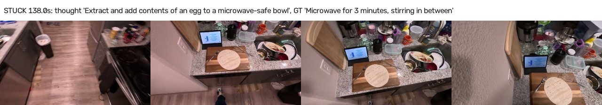
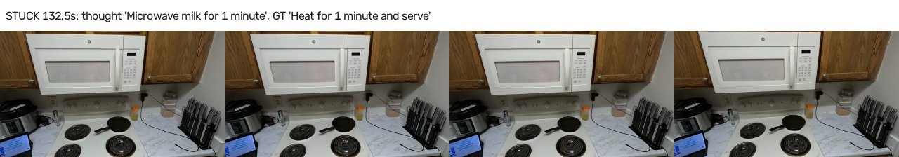
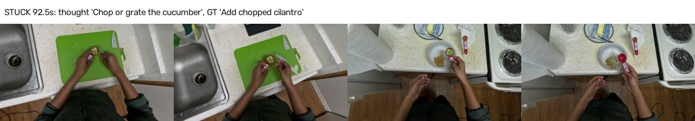
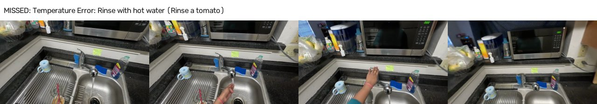
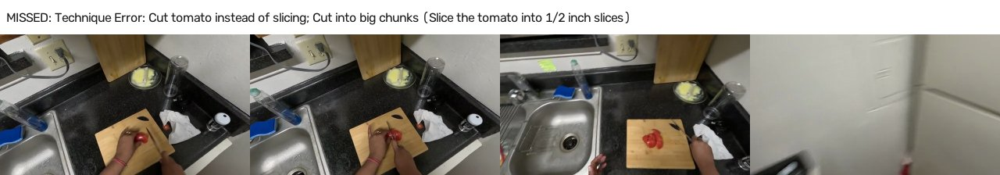
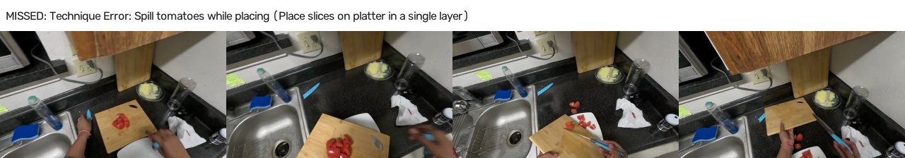
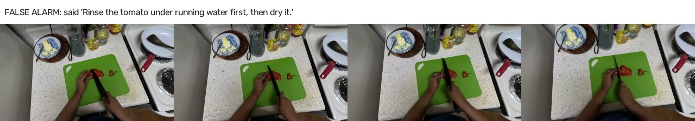
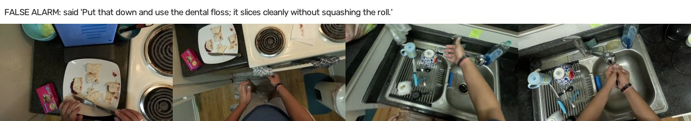
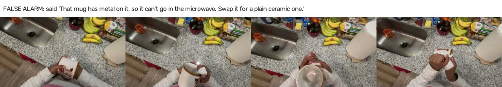

# Praxis prototype v0: measured results

*Instructions that can finally see how you're doing.* Every number below is generated by `prototype/praxis/write_results.py` from `results/metrics.json`, which lists the file each number comes from. Nothing was typed in by hand.

## Setup

- **Data:** CaptainCook4D, 48 held-out clips (234.9 min) across 8 procedure types (recipes). The clips contain 302 annotated step segments and 170 timed annotated errors. 33 of the clips contain at least one error. See `docs/DATA.md`.
- **Train/test hygiene:** everything learned uses only official train-split recordings. That covers the event detector, step probes, recognizer, calibration, student, policy thresholds, duration priors and compiler mistake hints.
- **Hardware:** Apple M4, 24 GB. The local layers run on MPS (see L1 speed below).
- **Engine (`fused`):**
  - Local layers: frozen SigLIP2 / V-JEPA 2 / hands features; a learned L2 event detector; trained step probes; the Bayesian state tracker.
  - Verifier tiers: Jev 1.14 is the fast tier; Claude Opus 5.5 is the strong tier for ambiguity, possible mistakes and poor views.
  - Policy: calibrated, with precision-first thresholds.
  - Two settings: `fused` recognizes the task itself (L3b); `fused_oracle` is told the task, which is the like-for-like comparison with the baseline.
  - The design was chosen on the train split only (see 'Design selection' below).
- **Stateless baseline:** the same strong model (Claude Opus 5.5) every 5 s, given the same frames. It gets no task graph, no state and no history: only the task name and the list of step names.

## Headline: stateful engine vs. stateless baseline

Both systems are told the task here. The stateless baseline is always given the task name and the step list, so the like-for-like comparison is with Praxis's task-given run (`fused_oracle`). Praxis recognizing the task by itself is reported in the next section.

| System | Step acc. | Mistake precision (time-window) | Mistake recall (time-window) | Caught / false alarms (time-window) | False alarms/min (time-window) | Model calls | Cost / video-min |
|---|---|---|---|---|---|---|---|
| Stateless baseline (Opus 5.5 every 5 s, task given) | 48% | 67% | 1% | 2 / 1 | 0.004 | 2817 | $0.085 |
| Praxis (stateful, task given) | 54% | 76% | 8% | 13 / 4 | 0.017 | 3030 | $0.018 |

- **Step tracking:** Praxis 54% vs baseline 48%, so Praxis is higher. This counts frames inside annotated steps. Excluding the 3 dev clips: 54% vs 49%.
- **Mistakes, strict scoring** (a judge model checks that the alert names the same problem as the annotation; see Methods): Praxis raised 17 alerts and 4 identified an annotated error (4 more were partially right). That is a strict precision of 24% and strict recall of 2.4%. The baseline raised 3 alerts and 2 were right (67%, recall 1.2%). Praxis catches more real mistakes but is less precise. Strictly counted false alarms: 0.055/min vs 0.004/min.
- **Mistakes, time-window scoring** (an alert counts if it lands near any annotated error, whatever it says; this is optimistic): Praxis caught 13 of 170 annotated errors with 4 false alarms. The baseline caught 2 with 1 false alarm. 77% of Praxis's catches came before the erroneous step ended.
- **Cost:** $0.018 vs $0.085 per video-minute (4.6× cheaper). Most Praxis calls are ~0.2 s typed Jev questions; Opus is used only for escalations.

Sources: `results/runs/fused_oracle.json`, `results/runs/baseline_stateless.json`.

## Fully automatic: Praxis recognizes the task itself

- Task recognized correctly on **73%** of clips. Median time to recognize: 40 s (p95 152 s), out of a library of 9 procedures.
- Step accuracy is 30% over the whole clip, and 37% after recognition. Frames before recognition, and clips where the wrong recipe was recognized, count as wrong.
- Mistakes, strict: 5 of 20 alerts identified an annotated error (strict precision 25%, recall 2.9%).
- Mistakes, time-window: 16 caught, 4 false alarms (0.017 per minute).
- Recognition mistakes are between visually similar recipes (see `results/l3b/recognition.json`). One wrong recognition costs that clip's whole step track.

Source: `results/runs/fused.json`.

## Multi-task: switching, pausing and resuming

The engine keeps a set of tasks: one is active, others can be paused with their progress. It keeps checking which task is happening, and it can switch to another task or resume a paused one. When the person walks away it pauses the job and asks "Coming back to the ...?"; a paused task closes only when the person says they're done, or at the end of the session (never on a timer). Settings were chosen on the train split only (docs/MULTITASK.md, sections 11-13). In automatic mode, gpt-6.1-sol answers "which task?": it guesses no task before 10 s, needs two agreeing answers, and switches above 0.9. That setting was adopted on train results; the pre-set rule did not choose it (results/multitask/sol_fix_train.json).

- **More training video:** the small local models were refit on all 70 train recordings (they had been trained on 24). Local-only step accuracy with the task given went from 41% to **49%** on the same 48 held-out clips. The train-split check (fold models trained on 16 vs about 47 recordings) showed the same direction: 54% to 61%.
- **Automatic mode on 48 single-recipe held-out clips** (`fused_mt`: multi-task engine, refit models, Jev fast tier, Opus strong tier, openai:gpt-6.1-sol deciding the task): step accuracy **43%** (the earlier automatic run `fused`, older models and single-task engine: 30%). First task guess right on 73% of clips, right task at the end on 83%. **5 wrong switches** across the 48 clips; 10 more wrong guesses were corrected. False alarms 0.017 per minute.

**SYNTHETIC multi-task sessions** (held-out clips spliced together, 167 min). CaptainCook4D has one recipe per video, so sessions are spliced at annotated step ends: a switch to another recipe, a switch and come back, or 60 s of a recipe that isn't in the library. The cuts are hard (the camera jumps), so switch latency here is not a real-life latency. Replay has no user, so "Coming back to ...?" is never answered. Same models and fast tier in both columns, no strong tier.

|  | Single-task engine | Multi-task engine |
|---|---|---|
| Step accuracy | 23% | 39% |
| Right task (share of time) | 42% | 63% |
| Switches caught (of 25) | 0 | 22 |
| Switch latency, median (hard cuts) | n/a | 57 s |
| Wrong switches | 0 | 7 |
| Job resumed after a switch (of 10) | 0 | 8 |
| Resume step exact / within one (of 10) | 1 / 2 | 5 / 6 |
| Interruption taken as a library task (of 6) | 0 | 1 |
| Interruptions paused with "Coming back to ...?" | 0 | 4 |

- **Repair footage (ENIGMA-51, SYNTHETIC splices, PROXY step labels):** across 108 min, a switch to a *different repair job* was noticed in 0 of 4 sessions. All four procedures name the same parts and tools, so the off-task signal could not tell the jobs apart. Of 4 unrelated interruptions, 2 were paused as designed and 2 became wrong switches.

Sources: `results/runs/fused_mt.json`, `results/multitask/eval_splices_mt.json`, `results/multitask/eval_splices_single.json`, `results/runs/local_only_v2models.json`, `results/multitask/learning_curve.json`, `results/enigma51/enigma_switch.json`.

## Organization backend on repair videos (ENIGMA-51, PROXY labels)

An organization profile received the four written repair procedures through the upload path. Each was compiled through the backend's compile endpoint, which shows its estimate first. Each was reviewed against its document, approved, and assigned, and then the profile was locked. Praxis then coached each first-person repair video, with the job set by its assigned procedure (like a work order), using only the approved procedures. gpt-6.1-sol answered both "is this step done?" and "which step now?"; it led Jev on both in the train-split tests. Only related footage was used. The reference steps are DERIVED from the dataset's object-interaction labels and the earlier script-compiled graphs, not from human step labels. A blind Opus judge graded each answer.

| Answer | Moments | Right | Off by one step | Wrong or none |
|---|---|---|---|---|
| Praxis on screen (backend-compiled procedures) | 66 | 30 (45%) | 19 | 17 |
| Praxis on screen (earlier script-compiled procedures) | 66 | 32 (48%) | 12 | 22 |
| General assistant + the written procedure | 66 | 24 (36%) | 6 | 36 |
| General assistant, no procedure | 66 | 21 (32%) | 1 | 44 |
| Step Praxis believes (backend-compiled) | 44 | 18 (41%) | 10 | 16 |
| Step Praxis believes (earlier script-compiled) | 44 | 27 (61%) | 5 | 12 |

- Videos: 107, 141, 144, 53. Believed-step rows cover only the moments judged for that arm (see the source file).
- **Technician questions** asked mid-task through the backend's ask endpoint (Opus 5.5, retrieval over all four documents), graded blind by gpt-6.1-sol against reference answers written from the documents beforehand: 16 of 20 correct, 2 partial, 2 wrong.

Source: `results/enigma51/backend_flow.json`.

## Latency

- **Feedback latency** (GT end of an action → Praxis says 'verified' or flags a mistake about that step), p50 / p95: **4.7 s / 138.7 s** (n=43). Part of this is policy: Praxis waits for evidence before speaking.
- **Progress latency** (GT end of a step → Praxis marks it done, either verified or because the belief moved on; signed), p50 / p95: 6.1 s / 192.6 s. The long tails come from the 'stuck belief' failures (see the failure analysis).
- **Verifier call latency** (live calls inside engine runs), p50 / p95: 192 ms / 6024 ms.
- **Share of frames escalated to the slow path:** 12.9%. Everything else is handled by the local layers.
- **Fast-path compute** (from the measured L1 speeds): at the engine's 4 fps, with one V-JEPA 2 window per second, the local layers need 325 ms of compute per second of video, about **3.1× faster than real time** on this Mac. Per frame: SigLIP2 20.1 ms and hands 5.7 ms; V-JEPA 2 221 ms per window. With V-JEPA 2 kept at 1 Hz, the per-frame encoders could run at up to 30 fps.

**L1 speed on this Mac** (MPS, fp16, measured with nothing else running):

| Backbone | Batch | ms / item | items / s |
|---|---|---|---|
| siglip2-base-224 (image) | 1 | 20.1 | 49.8 |
| siglip2-base-224 (image) | 8 | 13.7 | 73.1 |
| siglip2-base-224 (text x16) | 16 | 4.2 | 237.7 |
| dinov2-small (image) | 1 | 11.5 | 86.8 |
| dinov2-small (image) | 8 | 6.5 | 153.5 |
| vjepa2-vitl (16f@256) | 1 | 652.4 | 1.5 |
| vjepa2-vitl (8f@224) | 1 | 221.5 | 4.5 |
| mediapipe-hands | 8 | 5.7 | 175.2 |

Source: `results/l1/l1_speed.json`.

## Layer results

**L1 backbone quality.** A linear probe on frozen features measures held-out frame-level step accuracy. The engine's probe uses SigLIP2 + V-JEPA 2. That was chosen by leave-one-recording-out on the train split, where it narrowly beat SigLIP2 alone (`results/dev/probe_features_loro.json`). On the held-out clips below, SigLIP2 alone came out slightly ahead. We did not switch after seeing test data.

| Features | Held-out step acc. | Procedures |
|---|---|---|
| siglip2 | 44.1% | 8 |
| dinov2 | 32.4% | 8 |
| vjepa2 | 24.9% | 8 |
| siglip2+vjepa2 | 42.1% | 8 |
| dinov2+vjepa2 | 31.9% | 8 |

Source: `results/l1/l1_quality_and_probes.json`.

**L2 event detector** (step-boundary F1, peak picking, threshold tuned on held-out *train* recordings):

| Test set | Tolerance | Detector | Precision | Recall | F1 | Clips |
|---|---|---|---|---|---|---|
| held-out videos | ±2s | learned | 24% | 29% | 0.26 | 48 |
| held-out videos | ±2s | heuristic | 13% | 30% | 0.18 | 48 |
| held-out videos | ±5s | learned | 35% | 42% | 0.38 | 48 |
| held-out videos | ±5s | heuristic | 17% | 39% | 0.24 | 48 |
| held-out procedure types | ±2s | learned | 19% | 24% | 0.21 | 8 |
| held-out procedure types | ±2s | heuristic | 10% | 31% | 0.15 | 8 |
| held-out procedure types | ±5s | learned | 31% | 40% | 0.35 | 8 |
| held-out procedure types | ±5s | heuristic | 13% | 38% | 0.19 | 8 |

The detector head alone runs at about 265k frames/s on CPU. That excludes L1 features; the ≥10 fps target applies to the whole fast path (see the L1 speed table). Source: `results/l2/l2_event_detector.json`.

**L3 compiler.** 8 procedures compiled into typed graphs: 96 steps, 267 common-mistake entries, 207 typed checks. Total cost $4.16. Source: `results/l3/compile_summary.json`.

**L3b task recognition** on held-out clips:
- Top-1: **73%** over 48 clips (library of 9 procedures).
- Time to recognize, p50 / p95: 40 s / 152 s.

Source: `results/l3b/recognition.json`.

**Joining mid-task.** The engine starts 90 s into each of 48 clips, with the task given and no history. Step accuracy over the first 30 s:
- Mid-task prior: 47%.
- Assuming the task just started: 33%.
- Median time until the current step is localized: 2.0 s vs 5.5 s.

Source: `results/l3b/join_mid_task.json`.

**L4 state-tracker ablation** (task given, same clips):

| Tracker input | Step acc. | Verifier calls |
|---|---|---|
| Local evidence only (no verifier) | 41% | 0 |
| Verifier only (every 5 s, no local evidence) | 36% | 4731 |
| Fused (ours) | 54% | 3030 |

Sources: `results/runs/local_only.json`, `results/runs/verifier_only.json`, `results/runs/fused_oracle.json`.

**Gate.** With the SSIM heuristic gate instead of the learned L2 detector, step accuracy is 53% with 3172 verifier calls. The learned gate gets 54% with 3030 calls. Source: `results/runs/fused_heuristic_gate.json`.

**L5 verifiers on identical routine checks** (469 held-out GT checks: "is step k complete right now?" at mid-step vs 1.5 s after the annotated end):

| Verifier | Accuracy | AUROC | ECE raw | ECE calibrated | Latency p50 / p95 | Cost / check |
|---|---|---|---|---|---|---|
| jev (jev-1.14.0) | 62% | 0.70 | 0.223 | 0.021 | 151 ms / 269 ms | $0.00011 |
| claude_fast (claude-haiku-5-5) | 61% | 0.62 | 0.103 | 0.034 | 1330 ms / 2202 ms | $0.00022 |
| claude_strong (claude-opus-5-5) | 80% | 0.84 | 0.095 | 0.042 | 3781 ms / 6400 ms | $0.01077 |

Calibration is isotonic, fit on train-split checks only. Sources: `results/l5/compare_jev_vs_claude_fast.json`, `results/l5/calibration.json`.

**TAPNext++ ROI crops** (120 fine-grained eval checks, claude_strong):
- Accuracy: 79% with full frames vs 79% with crops.
- AUROC: 0.85 vs 0.86.
- Input tokens per call: 2402 vs 2573.
- TAPNext++ time per crop (p50): 9.0 s on this Mac.
- Protocol: seed a 6x6 grid on the hands' working area 1.6 s before the check, track at 10 fps with TAPNext++ (MPS), crop the tracked region (fallback: seeded hand area) from the full frame.
- Checks: eval checks whose node has orientation/alignment/quantity/part-identity checks.

Source: `results/l5/crops_vs_full.json`.

**Visual-uncertainty test.** On degraded views of mid-step eval checks, Praxis's typed verifier can say 'can't see'; the stateless baseline must answer.

| Degradation | Praxis asks for a view | Praxis confident (≥0.5) & wrong | Baseline confident (≥0.5) & wrong step | Baseline confident (≥0.7) & wrong step | Baseline step accuracy |
|---|---|---|---|---|---|
| none | 12% | 7% | 30% | 7% | 65% |
| blur | 98% | 0% | 12% | 2% | 18% |
| occlude | 77% | 0% | 23% | 3% | 30% |
| crop_away | 87% | 0% | 73% | 17% | 15% |

60 mid-step eval checks per condition; Claude Opus 5.5 in both arms.

Source: `results/l5/visual_uncertainty.json`.

**Adaptive detail (L6).** This is an association, not evidence that it helps users.
- Over 295 annotated eval steps, steps with errors have a median time-on-step ratio of 0.75, vs 0.81 for error-free steps (one-sided p = 0.92).
- Steps over 1.6× their prior have errors 59% of the time, vs a base rate of 57%.
- In the engine run, steps that got an expanded hint had errors 53% of the time, vs 56% overall (30 hinted steps).

Source: `results/l6/adaptive_detail.json`.

**L7 distillation.** A local student learns routine completion checks from claude-opus-5-5 verdicts plus train-split GT. On 469 held-out eval checks:
- Agreement with the teacher: **69%**.
- Accuracy vs GT: student 72%, teacher 80%.
- Latency: 0.03 ms on CPU vs 3790 ms.
- Cost per 1,000 checks: $0 vs $10.77.
- Routing at |p−0.5| ≥ 0.25 instead: the student handles 59% of checks, accuracy 79%, at 41% of the teacher's cost.
- Routing a check to the student only when it is confident (|p−0.5| ≥ 0.35): it handles 34% of checks, and accuracy is 81%.

Source: `results/l7/distill.json`.

**Verifier tiers inside the full engine** (task given; same clips, tracker and policy):

| Configuration | Run | Step acc. | Judge-verified catches / alerts | Strict false alarms/min | Model calls | Cost / video-min |
|---|---|---|---|---|---|---|
| Jev fast tier + Opus escalation (ours) | `fused_oracle` | 54% | 4 / 17 | 0.055 | 3030 | $0.0183 |
| Jev only, no escalation | `fused_no_escalation` | 53% | 3 / 24 | 0.089 | 2726 | $0.0012 |
| Claude Haiku 5.5 fast tier + Opus escalation | `fused_claude_fast` | 47% | 2 / 5 | 0.013 | 2565 | $0.0073 |
| Distilled student for completion checks + Jev for localization + Opus escalation | `fused_distilled` | 52% | 2 / 8 | 0.026 | 2981 | $0.0079 |
| Distilled student as the only fast tier (no localization) + Opus escalation | `fused_distilled_alone` | 20% | 2 / 8 | 0.026 | 2183 | $0.0227 |

The student has no localization head, so `fused_distilled_alone` loses the typed "which step?" question; `fused_distilled` keeps Jev for it. Swapping tiers is one line of config (`verifier.primary`). Sources: `results/runs/fused_oracle.json`, `results/runs/fused_no_escalation.json`, `results/runs/fused_claude_fast.json`, `results/runs/fused_distilled.json`, `results/runs/fused_distilled_alone.json`.

## Design selection (train split only)

Engine design choices were compared on train-split recordings, never on the eval clips. Step probes were trained leave-one-recording-out, the task was given, and the first 300 s of 24 recordings were used. The chosen design is the one evaluated above.

| Design (train split) | Step acc. | Calls | Cost | Mistakes TP / FP (time-window) |
|---|---|---|---|---|
| jev_ent0.85_default | 56.7% | 206 | $1.11 | 1 / 0 |
| jev_ent0.40 | 57.1% | 538 | $0.85 | 0 / 0 |
| jev_ent0.25 | 65.0% | 945 | $0.82 | 1 / 1 |
| opus_ent0.40 | 56.2% | 568 | $3.71 | 0 / 0 |
| opus_ent0.25 | 61.8% | 913 | $5.58 | 1 / 0 |
| jev_ent0.15 | 68.3% | 1238 | $0.73 | 0 / 0 |
| jev_ent0.10 | 68.4% | 1387 | $0.64 | 0 / 0 |
| jev_ent0.25_w0.5 | 56.7% | 979 | $0.79 | 0 / 0 |
| jev_ent0.25_w2 | 53.9% | 929 | $0.86 | 0 / 7 |
| ent0.15_screen_off | 68.3% | 1237 | $0.72 | 0 / 0 |
| ent0.15_screen_p0.5 | 61.5% | 1437 | $1.89 | 4 / 1 |
| ent0.15_screen_p0.7 | 63.9% | 1220 | $1.04 | 3 / 1 |
| ent0.15_screen_p0.5_alerts_only | 65.2% | 1440 | $1.95 | 4 / 2 |
| ent0.15_screen_p0.3_alerts_only | 65.2% | 1507 | $2.31 | 4 / 2 |

Chosen: {"tracker": {"local_weight": 0.1, "boundary_weight": 0.0, "commit_on_switch_p": 0.7}, "policy.entropy_verify": 0.15, "step_choice": true, "step_choice_weight": 1.0, "localizer": "jev", "mistake_screen": true, "mistake_screen_p": 0.5, "screen_updates_tracker": false, "verifier": "jev (fast tier)", "escalation": "claude-opus-5-5 (strong tier)"}. Source: `results/dev/final_design.json`.

## TAPNext++ point tracking on this Mac

| Device | Query points | ms / frame (p50) | Max fps | Points still visible after 3 s |
|---|---|---|---|---|
| mps | 16 | 594 | 1.7 | 0% |
| mps | 36 | 645 | 1.6 | 6% |
| mps | 64 | 656 | 1.5 | 6% |
| cpu | 16 | 1819 | 0.5 | 0% |
| cpu | 36 | 1042 | 1.0 | 6% |
| cpu | 64 | 1015 | 1.0 | 6% |

Measured while other jobs were running on the machine. TAPNext++ is far from real time here, and on head-mounted cooking video most points are lost within a few seconds. Crops were therefore computed offline for the crop experiment only; the live plan is in docs/MODEL_ROADMAP.md. Source: `results/l1/tapnext_speed.json`.

## Open-set drafting: recipes Praxis has never seen

The 4 CaptainCook4D recipe types outside the library (Coffee, Mug Cake, Ramen, Zoodles; 2 recordings each, first 240 s) were never compiled or trained on. The engine runs without the task. When the typed task check keeps answering "none of these", Praxis drafts a light task graph from what it has seen (steps, spoken instructions, visual end states; no mistake library) and tracks it with zero-shot local evidence, announced as a draft. A judge (Claude Opus 5.5) compares each draft with the dataset's own task graph for that recipe. Step accuracy after the draft maps annotated steps to draft steps through the judge's matching.

| Condition | Drafted | Announced a wrong library task | Recipe named (of drafted) | Reference steps covered | Draft steps matching a reference step | Step accuracy after the draft | Median draft time / drafting latency |
|---|---|---|---|---|---|---|---|
| Video only, draft after 30 s | 7 / 8 | 1 | 0 yes, 2 partial | 18% | 21% | 4% | 30 s / 13 s |
| Video only, draft after 90 s | 6 / 8 | 2 | 1 yes, 3 partial | 49% | 51% | 10% | 90 s / 16 s |
| Video + the person's description ("making <recipe>"), draft after 30 s | 7 / 8 | 1 | 5 yes, 2 partial | 64% | 58% | 36% | 30 s / 16 s |

Trigger: after the condition's earliest draft time, the typed task check answered 'none of these' twice in a row, or nothing was recognized by max(60 s, earliest draft time). Drafts and judgments are in `results/open_set/` (each draft graph is saved under `results/open_set/drafts/`). Source: `results/open_set/open_set.json`.

## Live mode (real-time loop, replayed recording)

`praxis.live` runs the whole engine in real time: L1 encoders on each incoming frame, L2, the tracker and the verifiers. No webcam was available to this build, so the test fed a recorded eval clip through the live loop at wall-clock speed. Frames the loop was too slow for were dropped, as a camera would drop them. Source: `replay:data/raw/cc4d/videos/10_18_360p.mp4@0.0`, task not given.

The same recording ran twice: first with model calls inline (a tick waits for its calls), then with the async slow path, which live mode now uses (`EngineConfig.async_slow_path`). Calls run on worker threads, the loop keeps ticking, and each answer is folded in when it arrives. The tracker applies a late answer at the tick its frames were taken and re-runs the filter forward from there; the policy acts on it when it arrives. Each run makes its own model calls, so which checks escalate differs between them. "Took effect" is measured from the log: when the answer's record was written, relative to the tick its frames came from.

|  | Model calls inline (the loop waits) | Async slow path (the loop never waits) |
|---|---|---|
| Task recognized | `cc4d_pinwheels` at 22.0 s | `cc4d_pinwheels` at 22.2 s |
| Frames processed at 4 fps | 577 of 605 (28 dropped) | 598 of 601 (3 dropped) |
| How far each 1 s tick finished behind the camera, p50 / p95 / max | 0.08 / 0.37 / 4.42 s | 0.10 / 0.15 / 0.77 s |
| Ticks skipped because all their frames were dropped (no tracker update) | 4 | 0 |
| Tick compute, p50 / p95 / max | 8 / 171 / 4352 ms | 8 / 25 / 490 ms |
| L1 per frame (SigLIP2 + hands; V-JEPA 2 at 1 Hz on a second thread), p50 / p95 | 51 / 101 ms | 50 / 83 ms |
| Completion checks (incl. Opus escalations): took effect after their frames, p50 / max | 3.32 / 4.4 s (n = 3) | 2.64 / 4.8 s (n = 2) |
| "Which step?" answers: took effect after their frames, p50 / max | 0.13 / 0.9 s (n = 17) | 0.26 / 0.5 s (n = 17) |
| Slowest request: model time / took effect after its frames / ticks the loop ran meanwhile | a Jev completion check escalated to Opus: 4.3 s / 4.4 s / 0 | a Jev completion check escalated to Opus: 4.4 s / 4.8 s / 4 |
| Requests that took over 1 s / ticks the loop ran while they were out | 2 / 0 | 1 / 4 |
| Model calls / spend | 27 / $0.020 | 25 / $0.014 |

- Inline, the slowest request (a Jev completion check escalated to Opus, 4.3 s of model time) held up the whole loop: the worst tick finished 4.4 s behind the camera, 28 frames were dropped, and 4 ticks had no frames left, so the tracker skipped them. With the async slow path the worst tick finished 0.77 s behind, 3 frames were dropped and 0 ticks were skipped; while its slowest request (a Jev completion check escalated to Opus, 4.4 s) was out, the loop ran 4 ticks.
- The async run's latest tick (at 126 s) started late with no model call out: local work before the tick (the encoders, the L2 detector re-scoring its buffer) ran long. Moving the slow path off the loop does not address that.
- Answers do not arrive sooner: they take effect once the models have answered. Completion checks took effect a median 2.6 s (max 4.8 s) after their frames in the async run, vs 3.3 s (max 4.4 s) inline. What changed is that the camera, encoders, tracker and policy keep running meanwhile.
- The async loop folds answers in between frames, so an answer took effect a median 0.25 s (max 0.49 s) after its call returned. In both runs some answers came from the response cache, because the replayed frames match earlier runs of this clip (13 of 24 requests inline, 16 of 23 async); those come back in milliseconds, so the "took effect" rows mix live calls and cache hits.
- Folding an answer in (logging it, re-running the filter from its tick, the policy) took 0.2 ms median and 8.7 ms at most on the main thread. No check had to be skipped as a duplicate of one still out.
- Offline replay is unchanged. `replay()` (every evaluation) keeps model calls inline. Re-running 10 eval clips on the model answers recorded in their saved logs, the engine asked the recorded questions in order (0 mismatches) and wrote 6717 of 6717 records exactly as the engine before this change did. Against the saved logs, 6680 of 6717 records are identical; the rest differ only in fields the log format gained after those runs (`action/detail.chip`, `action/detail.draft`); `task_draft/cached`: the replay's open-set draft comes from the drafting response cache (the saved run made the call). Eval scores recomputed from the logs are identical.
- Recorded answers were needed because cached re-runs were not reproducible: the Jev completion-check cache key included random per-request ids, so a re-run asked Jev again. Re-running the same clips on the caches (no code change) reproduced 4230 of 6720 records and the eval scores of 1 of 9 clips; its cache misses cost $0.054.
- The Jev cache key is fixed: it is now built from the image content (`verify/jev.py`). Clip 17_43_0, re-run 3 times on the caches: the first run asked Jev 8 of its 8 checks again (answers cached under the old key are unreachable; $0.0009). Each later run answered 8 of 8 from the cache and added 0 cache entries ($0.0000). The second run logged 699 of 707 records exactly as the first (the rest differ only in being marked cached at $0); run 3 matched run 2 in 707 of 707.

Render: `renders/live_replay_user.mp4` (drawn from `runs/live_replay_async/live.jsonl`, 16-112 s). Sources: `results/live/live_replay_10_18_0.json`, `results/live/live_replay_async.json`, `results/live/checks/replay_unchanged.json`, `results/live/checks/cached_rerun.json`.

## Personalization demo (L6 user model, qualitative)

The same clip (`10_18_0`) run twice with the profile fixed to novice and then to expert. Renders: `renders/policy_demo_novice_user.mp4`, `renders/policy_demo_expert_user.mp4` (80-135 s of the clip). Instructions given in that window:

| Time (novice / expert run) | Novice profile | Expert profile |
|---|---|---|
| 86 s / 88 s | Spread the nut butter in an even layer over the tortilla, but stop about half an inch before the edge all the way around. | Spread nut butter, half-inch border |
| 130 s / 130 s | Wipe the nut butter off the butter knife with a paper towel so it's clean for the jelly. | Wipe knife with paper towel |

The verifier prompts don't depend on the profile, but these are two separate live runs. Verifier calls were not identical (3 calls only in the expert run, 2 only in the novice run). Spend $0.014. No user study: this shows the mechanism, not a benefit. Source: `results/policy_demo.json`.

## Assembly demo (IndustReal, qualitative only, no ground truth)

- `ir_08_assy_2_4`: recognized as `industreal_assy` at 10 s from a library of 9 procedures. Renders: `renders/assembly_08_assy_2_4_user.mp4` and `_engineer.mp4`.
- `ir_07_assy_2_3`: recognized as `industreal_assy` at 10 s from a library of 9 procedures. Renders: `renders/assembly_07_assy_2_3_user.mp4` and `_engineer.mp4`.

No metric is computed from these clips. The official step labels were unreachable this weekend, and local evidence for this graph is zero-shot. Source: `results/industreal_demo.json`.

## Per-category results (Praxis, task given)

| Procedure | Clips | Step acc. | Mistake precision (time-window) | Mistake recall (time-window) | False alarms/min (time-window) |
|---|---|---|---|---|---|
| breakfastburritos | 6 | 60% | 100% | 8% | 0.00 |
| cucumberraita | 6 | 58% | 100% | 11% | 0.00 |
| herbomeletwithfriedtomatoes | 6 | 56% | 100% | 4% | 0.00 |
| microwaveeggsandwich | 6 | 48% | 100% | 7% | 0.00 |
| microwavemugpizza | 6 | 45% | 0% | 0% | 0.07 |
| pinwheels | 6 | 53% | 80% | 14% | 0.03 |
| spicedhotchocolate | 6 | 54% | 100% | 10% | 0.00 |
| tomatomozzarellasalad | 6 | 59% | 50% | 9% | 0.04 |

## Spend

Tracked API spend for this build: **$127.55**, summed from recorded costs (`results/spend.json`). The brief's approval threshold was $150. Not in the total:

- hand-run smoke tests and pilots on 2026-10-17 (model pings, Jev image probe, three 24-100 check prompt/framing pilots before the framing ablation was formalized, early 3-clip engine tests): not recorded per call; small relative to the total
- 72 mistake-judge calls (Opus 5.5, effort low, one short text prompt each) made before the judge stored per-call cost
- design-selection runs deleted after two processes wrote the same logs (WHAT_DIDNT_WORK.md); their re-runs reused the cached answers, so those calls' original cost is not in the total

## Showcase renders (real model output)

Every clip is drawn from a saved run log by `prototype/praxis/make_renders.py`, which also picks the clips by fixed rules (below). Development clips are excluded. These are chosen examples, so read them next to the aggregate numbers above; two are failure cases and are labeled as such on screen.

| Render | Files | Run · clip · time | What Praxis said | Annotated error | Selection rule |
|---|---|---|---|---|---|
| recognition and tracking | `renders/showcase_recognition_tracking_user.mp4` `renders/showcase_recognition_tracking_engineer.mp4` | `fused` · `22_24_0` · 34 s |  |  | highest step accuracy after recognition among clips recognized within 40 s |
| step tracking | `renders/showcase_step_tracking_user.mp4` `renders/showcase_step_tracking_engineer.mp4` | `fused` · `10_18_0` · 162 s |  |  | 45 s window with the most annotated step changes the engine followed within 10 s (task recognized by Praxis), ties broken by step accuracy in the window |
| caught mistake | `renders/showcase_caught_mistake_user.mp4` `renders/showcase_caught_mistake_engineer.mp4` | `fused` · `1_43_0` · 155 s | Use the knife to cut the muffin so you get clean, even halves. | Using hand instead of knife | first mistake alert the strict judge rated 'yes' (matches an annotated error) |
| caught mistake 2 | `renders/showcase_caught_mistake_2_user.mp4` | `fused` · `17_40_0` · 239 s | That looks like a zucchini, not a cucumber. Put it back and grab the cucumber instead. | Use zucchini instead of cucumber | second mistake alert the strict judge rated 'yes' |
| view request | `renders/showcase_view_request_user.mp4` | `fused_oracle` · `17_43_0` · 31 s | Look back at the sink and show the cucumber in your hands |  | first view request |
| failure false alarm | `renders/failure_false_alarm_user.mp4` | `fused` · `1_25_0` · 74 s | Give the ramekin a quick coat of cooking spray first so the egg won't stick. |  | first mistake alert with no annotated error within the matching window |
| failure wrong task | `renders/failure_wrong_task_user.mp4` | `fused` · `8_50_0` · 52 s | announced task `cc4d_microwavemugpizza` |  | first clip whose first announced task was wrong |

Source: `results/renders_index.json`.

## Methods notes

- **Mistake matching.** Time-window matching counts an alert that lands within [annotated error start − 5 s, end + 10 s] as a hit. Strict matching additionally has Claude Opus 5.5 judge each such pair with a fixed rubric (yes / partial / no: does the alert name the same problem?). Code: `prototype/praxis/eval/semantic_match.py`. The judged pairs, with reasons, are in `results/l6/mistake_semantic_*.json`.

## Failure analysis (run `fused_oracle`)

Counts: stuck belief 42, missed mistake 155, false alarm 4.

Mistakes caught vs. missed, by annotated error type (time-window matching):

| Error type | Caught | Missed | Recall |
|---|---|---|---|
| Measurement Error | 2 | 31 | 6% |
| Order Error | 12 | 84 | 12% |
| Preparation Error | 3 | 57 | 5% |
| Technique Error | 6 | 36 | 14% |
| Temperature Error | 0 | 8 | 0% |
| Timing Error | 1 | 9 | 10% |

**stuck belief** examples:
- `7_18_0` at 300 s: seconds=138.0; gt=Microwave for 3 minutes, stirring in between; pred=Extract and add contents of an egg to a microwave-safe bowl
  
- `8_44_0` at 300 s: seconds=132.5; gt=Heat for 1 minute and serve; pred=Microwave milk for 1 minute
  
- `17_40_0` at 218 s: seconds=92.5; gt=Add chopped cilantro; pred=Chop or grate the cucumber
  

**missed mistake** examples:
- `12_43_0` at 43 s: gt=Temperature Error: Rinse with hot water; step=Rinse a tomato
  
- `12_43_0` at 98 s: gt=Technique Error: Cut tomato instead of slicing; Cut into big chunks; step=Slice the tomato into 1/2 inch slices
  
- `12_43_0` at 149 s: gt=Technique Error: Spill tomatoes while placing; step=Place slices on platter in a single layer
  

**false alarm** examples:
- `12_51_63` at 7 s: said=Rinse the tomato under running water first, then dry it.
  
- `10_50_0` at 244 s: said=Put that down and use the dental floss; it slices cleanly without squashing the roll.
  
- `3_13_0` at 37 s: said=That mug has metal on it, so it can't go in the microwave. Swap it for a plain ceramic one.
  

### What the failure examples show (from inspecting the frame strips under `results/figures/failures/`)

These notes come from looking at the example frames listed above, from the task-given run (`fused_oracle`). The counts come from `results/failures.json`.

1. **Visually identical or invisible steps make the belief stick.**
   - In the longest stuck stretches, the step that is happening looks the same as the one Praxis believes.
   - One example is "microwave milk for 1 minute" vs "heat for 1 minute and serve": both are just waiting at the microwave.
   - Another is a step that runs off-camera. The person walks away while the microwave runs, and nothing visible says the step changed.
   - The duration prior eventually moves the belief forward, but slowly.
   - Fix direction: use the timer and appliance state when a step is "wait for X", and let a step end when the camera leaves the work area for a long time.
2. **Joining partway through a recording causes false order alarms.**
   - Clip `12_51_63` starts 63 s into its recording. The person had already rinsed the tomato before the clip began, so when they started slicing, Praxis said "rinse the tomato first".
   - The order check assumes the first step it sees confidently is the first one done. That is right at the true start, wrong when joining mid-task.
   - Fix direction (not applied, since the eval set was already run): when the first confident localization is not a start step, mark its graph ancestors as done before enabling order checks. `assume_done_before` already exists.
3. **Plausible-looking but wrong mistake calls.**
   - A mug with a decorative rim was flagged as "has metal on it, can't go in the microwave". The dataset has no such error.
   - The strong verifier sees something that could be a problem and the mistake library offers it a matching entry.
   - Precision-first thresholds keep these rare. The measured false-alarm rate is in the tables above, generated from
     `results/runs/*.json`.
4. **Fine-grained technique errors are missed at 360p with head motion.**
   - "Cut into chunks instead of slicing" needs a clear look at the cut pieces.
   - Head-mounted 360p frames are small and often blurred at exactly that moment.
   - The ROI-crop experiment (`results/l5/crops_vs_full.json`) tests whether zoomed evidence helps.
5. **Most annotated errors are not visible at all.**
   - Measurement errors (1 tbsp vs ½ tbsp), temperature (hot vs cool water) and preparation substitutions (whole vs skimmed milk) can't be seen from a few frames.
   - They make up most of the missed mistakes by type.
   - Order errors are the type Praxis catches most, through the stateful order check.

## What didn't work (engineering log)

Each item lists the symptom, the cause, and what changed. Numbers cite the files that hold them.

1. **IndustReal (toy-car assembly) labels were unreachable.**
   - Symptom: no assembly metric in this build.
   - Cause: IndustReal's only official host (data.4tu.nl) refused connections from this machine all
     weekend. It answered once, briefly, on Saturday morning during research.
   - What changed:
     - A Hugging Face mirror supplied 44 of the 84 videos, but without labels.
     - Assembly appears only in clearly labeled qualitative demos ("no ground truth on this clip").
     - A poller kept retrying the official labels.

2. **Every API call from Python took 30–40 s.**
   - Cause: IPv6 is black-holed on the development network (VPN). Python tries the AAAA address first
     and waits for a connect timeout. curl's happy-eyeballs hid the problem.
   - Fix: IPv4-first resolution in-process (`praxis/paths.py`). Calls dropped to ~1.3 s (Claude Haiku) and
     ~0.15 s (Jev).

3. **Hugging Face Hub update checks hung model loading.**
   - Symptom: processes sat at 0% CPU for minutes.
   - Fix: run offline from the local cache.

4. **The Mac was swap-bound.**
   - Symptom: 24 GB RAM with ~31 GB of swap in use from other apps. Feature extraction ran at ~0.5×
     real time when contended, versus ~3× uncontended (`results/l1/l1_speed.json`).
   - Response: serialized GPU jobs and limited decode threads.

5. **Verifiers said "in progress" for steps that were visibly done.**
   - Haiku, Sonnet and Opus all answered "in progress" ~90% of the time 1.5 s after an annotated step end.
   - Cause: the expected end state included quality criteria ("uniform slices, clean board"), so the models
     treated imperfect work as unfinished.
   - Fix: prompt v3 separates *whether* a step was done from *how well*; quality problems go to the mistake
     field.

6. **Three recent frames weren't enough evidence.**
   - Head-mounted frames at step ends are often motion-blurred as the person turns away.
   - Fix: sharpness-based keyframe selection plus a temporal span (one frame from ~8–6 s ago and the two
     sharpest of the last 3 s).
   - This raised Opus AUROC 0.775 → 0.864 and Sonnet 0.646 → 0.732, but did nothing for Jev or Haiku
     (`results/l5/framing_ablation.json`).

7. **Small verifiers judge step completion poorly.**
   - On 469 held-out checks, AUROC was Haiku 0.62, Jev 0.70 and Opus 0.84 (`results/l5/verifier_*.json`).
   - Single-moment completion from a few 360p egocentric frames is hard. This is why the state tracker, not
     the verifier, carries step tracking, and why ambiguity escalates to Opus.

8. **TAPNext++ was not usable live on this machine.**
   - At the engine's 4 fps on head-mounted video it lost the points within ~1.5 s.
   - At 10–15 fps it ran at ~0.7 s/frame on a loaded M4 (MPS), roughly 30–60 s per 2 s clip window.
   - Response: crops were computed offline for the crop experiment only. The live path is documented as
     future work (fewer points, CoreML/ANE, or tracking on a server).

9. **The first L2 event detector overfit.**
   - It chose its threshold on its own training data (thr = 0.9) and scored worse than the SSIM heuristic
     on held-out clips (F1 0.04 vs 0.12).
   - Fix: a validation split of train recordings for early stopping and threshold tuning.

10. **Zero-shot task recognition locked onto the wrong recipe within seconds.**
    - Cause: SigLIP2 frame vs. title text matching is too weak.
    - Fix: a typed Jev "which task is this?" check that feeds the recognizer. Praxis announces a task only
      when the latest check supports it.
    - Later, a recognizer trained on only 1–2 recordings per recipe was overconfident and drowned out the
      verifier. Fixed by tempering local evidence per second.

11. **Time on step does not predict errors on CaptainCook4D.**
    - Steps with annotated errors are not slower: median ratio 0.75 vs 0.81, p = 0.92
      (`results/l6/adaptive_detail.json`).
    - Most errors are measurement, order or preparation slips that don't slow people down. Technique,
      temperature and timing errors do show longer ratios.
    - The adaptive-detail logic is kept, because it addresses hesitation, not errors. We do not claim it
      detects mistakes.

12. **An invalid engine run, caught and re-run.**
    - In the first `fused_claude_fast` run (Claude Haiku as the fast tier), every typed "which step?" call raised a
      TypeError, because the Claude localizer didn't accept the mistake-screening argument. That run measured Haiku
      *without* localization.
    - It is kept in `results/invalid_runs/` and labeled. The fixed run replaces it.
    - Similarly, using the distilled student as the *only* fast tier removed localization entirely (the student has no
      localization head). It is reported as `fused_distilled_alone`, next to the intended configuration: the student
      on completion checks plus Jev localization.

13. **The crop experiment deadlocked on the first try.**
    - Two verifier threads shared one TAPNext++ tracker, so each overwrote the other's online tracking state. They
      made no progress for about 40 minutes.
    - Fix: compute crops sequentially with a single tracker and cache them, then run the verifier calls in parallel
      over the cached crops.

14. **Two design-selection processes wrote the same run logs.**
    - Symptom: train-split design-selection logs with interleaved records from two runs.
    - Cause: a `pkill` pattern didn't match the first process, so a restarted run and the old one wrote to the same
      files at once.
    - Fix: the affected runs were deleted and re-run in one process, and run logs are now written atomically
      (temporary file + rename). The re-runs reused cached model answers, so the deleted runs' original API cost is
      listed as untracked in `results/spend.json` rather than estimated.

15. **Point-tracked crops did not help the verifier enough to keep.**
    - On 120 fine-grained eval checks (orientation, alignment, quantity, part identity), Opus with tracked crops
      matched Opus with full frames on accuracy and gained only about 0.01 AUROC (`results/l5/crops_vs_full.json`).
    - TAPNext++ took several seconds per crop on this Mac, and on head-mounted video the points drift off the
      hands quickly.
    - Crops stay off by default. A faster tracker, or crops from hand boxes alone, would be the next thing to try.

16. **Live mode crashed on its first real-time run.**
    - Symptom: a Metal assertion ("A command encoder is already encoding to this command buffer") a few seconds
      in.
    - Cause: the V-JEPA 2 thread and the main loop's SigLIP2 call used the GPU (MPS) at the same time.
    - Fix: one lock around GPU calls. After that, a 151 s real-time replay ran end to end (`results/live/`).
    - Then: verifier calls ran inside the loop, so a frontier-model escalation blocked the fast path for a few
      seconds; frames were dropped and whole ticks skipped meanwhile.
    - Fixed: in live mode the slow path runs on worker threads (`EngineConfig.async_slow_path`). Each answer is
      folded in when it arrives and applied to the tracker at the tick its frames were taken. Before and after on
      the same recording: `results/live/live_replay_10_18_0.json` and `results/live/live_replay_async.json`
      (RESULTS.md, "Live mode").

17. **The first async version announced the task a tick late.**
    - Symptom: in a short smoke run, the recipe was announced one tick later than with model calls inline, although
      the "which task?" answer had come back within milliseconds.
    - Cause: that version applied "which task?" answers at the next tick rather than when they arrived.
    - Fix: every answer, including task checks and open-set drafts, is folded in on the first frame after it
      arrives (`Engine.poll`).

18. **A cached re-run could not show that the evaluation was unchanged.**
    - Symptom: re-running eval clips on the response caches, with no code change, gave different logs and
      different eval scores, and made new paid calls (`results/live/checks/replay_unchanged.json`,
      `cached_rerun_attempt`).
    - Cause: the Jev completion-check cache key included the random per-request ids of the image assets
      (`verify/jev.py`), so those checks never hit the cache, and Jev's answers vary from call to call.
    - What changed: the check (`praxis/eval/replay_check.py`) feeds the engine the answers recorded in the saved
      logs and verifies that it asks the same questions in the same order.
    - Fixed: the key is now built from a copy of the request with each image id replaced by its position, plus the
      image bytes. The request sent to Jev is unchanged (`prototype/tests/test_jev_cache_key.py`).
      - Answers cached under the old key stay unreachable, so the first re-run after the fix asks Jev again.
      - On one eval clip (17_43_0, run three times on the caches, `results/live/checks/cached_rerun.json`): the first
        run asked Jev all 8 of its checks ($0.0009). The second and third answered 8 of 8 from the cache and made
        no calls; before the fix, a cached re-run of this clip answered 0 of 8 from the cache.
      - The second run logged the same records as the first, except that its 8 Jev answers are marked cached at $0.
        The third matched the second record for record.

## Limitations

- **One labeled domain.** All metrics are on CaptainCook4D (cooking). Assembly appears only in qualitative demos,
  because the IndustReal labels were unreachable this weekend.
- **Video.** Head-mounted GoPro footage at 360p. Smart-glasses framing, resolution and compression will differ
  (docs/GLASSES.md).
- **Clips.** Each clip is at most 5 minutes. Most start at the beginning of the recording, so recognition is mostly
  measured from the start; joining mid-task is measured separately.
- **Step accuracy** counts frames inside annotated steps only. Between-step frames are reported separately.
- **Mistake matching.**
  - Matching is by time window: an alert counts if it lands up to 5 s before the erroneous step starts and up to
    10 s after it ends. It is not matched by mistake type.
  - "Missing Step" errors have no timestamp, so they are excluded.
  - Some CaptainCook4D errors, such as measurement errors (1 tbsp vs ½ tbsp), are hard to see from a few frames.
- **Verifier checks** are asked at fixed moments relative to the annotations (mid-step, and 1.5 s after the step
  ends). They stand in for the moments the engine chooses itself.
- **Small training sets.** 3–5 train recordings per procedure for the step probes, and one run per variant (no
  seeds or confidence intervals). Per-procedure numbers rest on only 6 clips each.
- **Development clips.** Three eval clips were used while debugging (results/dev_clips.json). Headline aggregates
  are also reported without them.
- **Cost** uses list prices. Cached responses are priced at their original cost.
- **Latency.**
  - API latencies are live wall-clock times from this network after the IPv4 fix.
  - L1 speeds were measured with nothing else running. The machine was swap-bound during the eval runs, so those
    runs were slower than these speeds suggest.
- **No users.** Nothing here measures whether coaching helps people. The adaptive-detail result is an association
  on public data.
